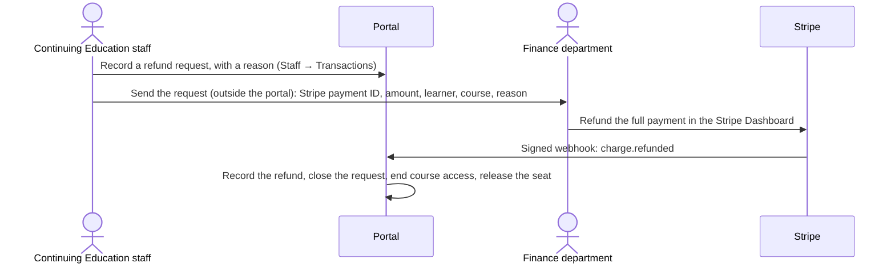

# How the portal works with Stripe

For the university Finance department, and for whoever builds and hosts the portal. Updated October 8, 2026. Technical decision record: [ADR 0005](../adr/0005-stripe-hosted-checkout.md).

## Summary

The Continuing Education portal takes course payments through **Stripe-hosted Checkout**. Learners pay on Stripe's own page, so card details never reach university systems. Stripe tells the portal about payments and refunds through **signed webhook notifications**, and the portal never moves money itself. **The Finance department issues every refund in the Stripe Dashboard.** Continuing Education staff record a refund request in the portal and send it to Finance; from then on the refund happens outside the portal, and Stripe reports the result back automatically. Finance does not need to use the portal. Today this runs against a Stripe **sandbox** (test mode) on a developer's computer; going live needs the access listed under [Access needed](#access-needed).

## How a payment works

```mermaid
sequenceDiagram
    actor Learner
    participant Portal
    participant Stripe
    Learner->>Portal: Reserve a seat (held 30 minutes)
    Learner->>Portal: Pay with Stripe
    Portal->>Stripe: Create Product and Price for the course (first time only)
    Portal->>Stripe: Create a Checkout session (31 minutes; the seat hold extends to cover it)
    Portal-->>Learner: Redirect to checkout.stripe.com
    Learner->>Stripe: Pay by card, Apple Pay or Google Pay
    Stripe-->>Learner: Return to the portal (a message only)
    Stripe->>Portal: Signed webhook: checkout.session.completed
    Portal->>Portal: Check amount, currency and reservation; record the order; start enrollment
```

- **Only the webhook counts.** The page Stripe returns the learner to never marks anything paid.
- **Missed notifications:** every 30 seconds the portal asks Stripe about checkout sessions that expired without a notification. Paid ones are recorded; unpaid ones are expired. A seat is not released while its payment is unresolved.
- **One order per payment.** The portal checks the amount and currency against the reservation and records each Stripe event once, so repeated notifications cannot double-record a payment.

## How a refund works



- **The handoff leaves the portal.** Once Continuing Education staff send the request, Finance works only in Stripe. The portal needs nothing more from anyone: Stripe's notification closes the request and updates the learner.
- **What Finance needs in the request:** the Stripe payment ID, amount, learner's email, course and reason. In Staff → Transactions, **Copy for Finance** copies exactly that (plus a Stripe Dashboard link for Finance) to paste into an email or ticket. How requests are sent is for Finance to choose.
- **The portal never refunds.** Its Stripe key has no refund permission.
- **Full refunds only** (policy). If a partial refund is made in Stripe anyway, the portal records it and flags it for review; course access is unchanged.
- **A full refund ends course access.** The registration becomes "Refunded, access ended" and the seat is released. Removing the learner from the Canvas course is a manual step for the Canvas administrators until Canvas is connected.
- **Learners can register and pay again** after a refund. The new payment is a new order; the refunded one stays in the history.
- **Refunds made in Stripe without a portal request** are still recorded and flagged.
- **A request that is no longer needed** can be cancelled in the portal, with a reason; Continuing Education staff then tell Finance not to proceed.

## What the portal asks Stripe to do

| Stripe API call | When | Permission the key needs |
| --- | --- | --- |
| Create, read and update **Products** | First payment for a course; renaming follows course edits | Products: Write |
| Create **Prices** | A course's first payment at a given price | Prices: Write |
| Create, read and expire **Checkout Sessions** | A learner selects Pay with Stripe; reconciling missed notifications | Checkout Sessions: Write |
| List **Refunds** for a charge | When a refund arrives, to store the Stripe refund ID (optional; skipped if not permitted) | Refunds: Read |

Nothing else: no refunds, payouts, customers, disputes or account settings.

## What Stripe tells the portal (webhook events)

| Event | What the portal does |
| --- | --- |
| `checkout.session.completed` | Records the paid order and starts enrollment |
| `checkout.session.async_payment_succeeded` | Same (kept for safety; delayed payment methods are not offered) |
| `checkout.session.async_payment_failed` | Stored only |
| `checkout.session.expired` | Marks the session expired; the seat is released when the hold ends |
| `charge.refunded` | Records the refund, closes the request and, for a full refund, ends access |
| `charge.dispute.created` | Stored for reconciliation (dispute handling is not decided yet) |

Every notification must carry a valid Stripe signature for the endpoint's signing secret; unsigned or altered requests are rejected.

## What appears in Stripe

- **Products:** one per course, named after the course, with the portal's offering ID in metadata. A price change creates a new Price.
- **Payments:** the course price in USD, the learner's email (for Stripe receipts), and metadata `entitlement_id` (registration), `offering_id` (course) and `learner_id`, which Finance can use to match Stripe payments to portal records.
- **No tax:** Stripe Tax is off and Checkout shows no tax. The university does not collect tax on these courses.
- **Payment methods:** cards, which include Apple Pay and Google Pay. Bank debits, buy-now-pay-later and Link are not offered.

## Data shared with Stripe

| Data | Why |
| --- | --- |
| Course title and price | Product, Price and the Checkout line item |
| Learner email | Pre-fills Checkout; Stripe receipts |
| Internal IDs (registration, course, learner) | Matching payments to portal records |

The learner enters card details and billing ZIP code on Stripe's page; the portal never sees them.

## Access needed

### For the portal's connection to Stripe

Set up by a Stripe Administrator of the university's account, for each environment (sandbox now, live later), and handed to whoever builds and hosts the portal:

1. **A restricted API key** (`rk_test_…` in the sandbox, `rk_live_…` in live), with:

   | Resource | Permission |
   | --- | --- |
   | Checkout Sessions | Write |
   | Products | Write |
   | Prices | Write |
   | Refunds | Read (optional) |
   | Everything else | None |

   The prototype refuses live keys until production is approved. A restricted key limits the damage if it ever leaks; the portal only calls the APIs above.
2. **A webhook endpoint** for the live environment, at the portal's public HTTPS address `…/api/v1/webhooks/stripe`, subscribed to the six events above. Its **signing secret**, like the API key, goes to whoever hosts the portal and is kept in the hosting platform's secret settings, never in email, chat or the code repository. (In the sandbox, the portal developer uses `stripe listen` instead.)
3. Account settings to confirm: business name and statement descriptor, Checkout branding, customer emails for successful payments and refunds, **Stripe Tax off**, and **Link turned off** for this account if Finance prefers (the portal already hides it).

### Who needs Stripe access

- **Portal staff: none.** They never open the Stripe Dashboard. Staff → Transactions shows each Stripe payment ID, and **Copy for Finance** produces the request text, including the ID and a Dashboard link for Finance.
- **The Finance department** manages its own Stripe users and roles; that is outside Continuing Education.
- **The portal developer** works in a Stripe sandbox during development. For live, the university's Stripe administrator creates the restricted key and webhook endpoint and hands them over; the developer does not need Dashboard access to the live account.

## Questions for Finance

1. How should Continuing Education send refund requests (email address or ticket queue), what must a request include, and what is the expected turnaround?
2. How do Stripe payouts and reports map to university accounts (cost center, GL codes)? The payment metadata above is available for matching.
3. How should disputes (chargebacks) be handled, and does a lost dispute end course access?
4. Should Stripe send payment and refund receipts, and from which business name?
5. Who in the university's Stripe account creates the live restricted key and webhook endpoint and hands them to the portal developer, and how (a secure channel, not email)?

## Going live (later)

- Live restricted key and live webhook endpoint (no `stripe listen`).
- A real end-to-end payment and refund with Finance watching both systems.
- Remove the prototype's simulated payment command.
- Agree on reconciliation reports and the dispute policy.
