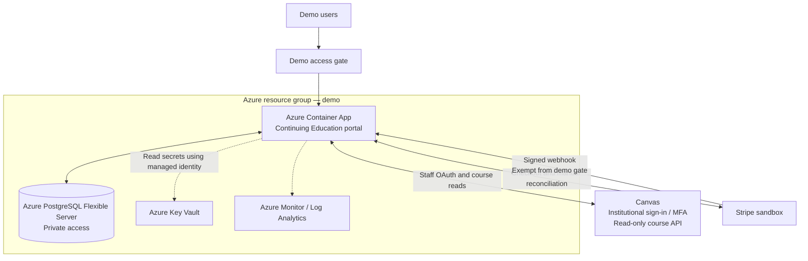
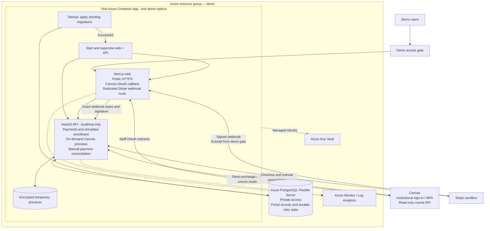
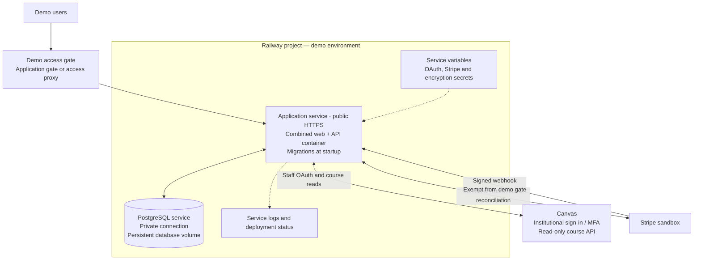

# Continuing Education portal: demo deployment plan

Updated October 15, 2026. Proposed deployment of the current request-driven demo. These diagrams describe the target hosting setup; the local implementation has not been deployed by this plan.

Use **one application container running web and API**, with **PostgreSQL outside the container**. Apply pending migrations at startup before serving traffic. There is no always-running worker, and scheduled Canvas synchronization is deferred. This follows [ADR 0008](../adr/0008-request-driven-demo.md).

## Runtime and demo boundaries

- Next.js exposes the public website. NestJS listens on localhost inside the same container, reached through the web server's API proxy.
- Normal simulated enrollment completes in the payment transaction. Delayed/failure simulations and expiry resume on authenticated API requests; they pause without traffic.
- Canvas previews run on demand with staff OAuth. Explicit course selection creates offering drafts. The connector does not write to Canvas.
- Support or Staff administrators manually recover overdue unresolved Stripe sessions using **Transactions → Check Stripe payments**. Payments remain in Stripe test mode.
- Existing-account learner login supports identity-only Canvas OAuth, including staff acting as learners, with independent revocable sessions. Guest authentication before account creation, paid Cedarville guest provisioning, real Canvas enrollment and learning records remain planned. See [learner login](../canvas-learner-auth.md).
- Temporary encrypted course previews stay inside the app container. Losing them during a restart requires a fresh preview; portal records and durable retry state remain in PostgreSQL.
- Start with one replica and one active application revision for the demo. Rolling deployments can temporarily overlap instances; preview requests must recover gracefully if they reach an instance without the preview file. Multiple steady-state replicas need shared preview storage.

## Azure: overview

This view hides the processes inside the Container App.

The gate protects the demo website, including mock learner access. It is separate from Canvas staff OAuth and portal role checks. Azure Container Apps built-in authentication is a candidate gate; restrict it to the intended demo audience and configure the webhook exemption explicitly.

## Azure: inside the Container App

The same Azure setup, expanded to show startup and internal processes.

The migration command exits after success; it is not a fourth running service. The process supervisor must stop both processes cleanly and fail the container when a required process exits. Public ingress targets only Next.js. The API remains on loopback and the database uses private networking.

Build the image in CI and store it in Azure Container Registry. Grant the app's managed identity only the required secret-reading access. Keep database credentials, OAuth client secrets, token-encryption keys and API broker tokens out of the image. Configure log retention and a spending alert. Container sizing, scale-to-zero behavior and monthly cost need measurement during rehearsal; no always-running scheduler requires a minimum replica anymore. Keeping one instance warm is an optional demo responsiveness choice.

## Railway: equivalent overview

Use the same combined app image as **one Railway application service**, plus a PostgreSQL service with persistent storage. Do not create separate web, API or worker services for this demo layout.

Only the application service needs a public domain. Connect it to PostgreSQL through the project's private network, configure secrets as service variables, and configure database backups. Temporary previews do not need a volume for this single-instance demo; refreshing after a deployment is acceptable. Keep durable data in PostgreSQL.

## Shared deployment preparation

These are implementation tasks, not completed hosting configuration.

| Task | Required result |
| --- | --- |
| Container build | Reproducible image containing the built website, compiled API, generated Prisma client, migration tooling and reviewed migration files. No development server or live credentials in the image. |
| Startup | Apply migrations against the hosted database, stop on failure, then start web and API under supervision. Retain migration locking and safe repeat behavior. |
| Network settings | Public web host/port configurable for the provider. API host remains loopback inside this combined container; the web proxy targets that local address. |
| Hosted-demo mode | Deliberately adapt the local-only environment guard for a gated hosted demo. Keep prototype/synthetic-data restrictions and refusal of live Stripe keys. Do not work around it by running development servers. |
| Access gate | Protect pages, API proxy and media routes for the selected audience. Exempt only the dedicated signed Stripe webhook route. Keep Canvas OAuth state, nonce, cookie and role checks. |
| Stripe ingress | Add public `POST /api/webhooks/stripe` forwarding to local `/api/v1/webhooks/stripe`, preserving raw bytes and `Stripe-Signature`. Validate signatures at the API. |
| Hosted URLs | Set the HTTPS `WEB_URL` and exact Canvas callback URL, and register the callback on the developer key. Replace or hide links to local API documentation. |
| Secrets | Configure database connection, broker tokens, Canvas OAuth settings, encryption key and Stripe test/webhook keys without committing them. The hosted webhook signing secret comes from its Stripe endpoint, not the local CLI listener. |
| Health and shutdown | Separate readiness from liveness; confirm database/migration readiness and both processes. Health checks must not advance simulations. Handle termination signals and recover durable work on later requests. |
| Database | Use a separate demo database, verify connection security, enable backups and prove restoration into another database. Preserve the existing local database. |

## Deployment sequence and acceptance

1. **Prepare locally:** implement packaging, startup, hosted-demo settings, gate and webhook forwarding on a feature branch. Rehearse the combined container against a separate database.
2. **Choose the host:** confirm the department/IT account owner, audience, region and spending budget. Use the same app image for either provider. The provider comparison is in [Azure versus Railway](azure-vs-railway.md); its earlier three-service diagrams and dated prices are historical alternatives.
3. **Configure the demo environment:** create the app and database resources, load secrets, configure the access gate, and register hosted OAuth and Stripe test endpoints. Infrastructure changes and deployment require a separate implementation request.
4. **Deploy and verify:** confirm migration success, web/API health, gate enforcement, staff OAuth and portal roles, manual Canvas preview/import, signed test payment, duplicate webhook handling and manual Stripe recovery. Do not create real learner identities or Canvas enrollments.
5. **Exercise recovery:** restart with a pending delayed simulation and resume it through an authenticated request; re-read a lost preview; verify expired reservations and uncertain Checkout holds. Confirm a failed migration prevents serving the new version.
6. **Review before sharing:** check keyboard/axe behavior and perform manual screen-reader review of affected workflows. Verify logs contain no secrets, backups are restorable, and an accountable person can investigate failures.

Keep the previous application image available for rollback. Prefer backward-compatible additive migrations; rolling back an app does not roll back the database. Never reset the database volume or delete paid/demo history as an application rollback.

## References

- [Request-driven demo decision](../adr/0008-request-driven-demo.md)
- [Current next steps](../next-steps.md)
- [Canvas OAuth setup](../canvas-staff-auth.md) and [course connector](../canvas-courses.md)
- [Azure Container Apps ingress](https://learn.microsoft.com/en-us/azure/container-apps/ingress) and [built-in authentication](https://learn.microsoft.com/en-us/azure/container-apps/authentication)
- [Railway private networking](https://docs.railway.com/networking/private-networking) and [volumes](https://docs.railway.com/volumes)
