# Continuing Education Portal: Implementation Plan

Status: implementation baseline updated October 21, 2026. The current-state sections and diagrams describe the local prototype as implemented. Remaining delivery milestones and explicitly marked target workflows are proposals; production policy and infrastructure decisions remain with the named owners.

Original planning tracker: [GitHub issue #1](https://github.com/dr-grizz/Continuing-Education/issues/1). Subsequent local updates, including workflow diagrams and API requirements, have not been synchronized to that issue.

## Recommendation and source

Build an API-first modular portal: Next.js with React/TypeScript and **Material UI** for the website, a NestJS REST API, PostgreSQL, and durable operation records. The current demo processes work on demand without an always-running worker; future live provisioning needs a durable runner. The website and authorized automation use the same application services and business rules. Use established library components and Cedarville branding throughout. Deliver a working sandbox registration flow before expanding the feature set.

This plan adapts `course-portal-implementation-plan-v2.md`, supplied from `/Users/hye/Downloads/working_dir/course-portal-planning/`. The supplied document is source material, not authorization to provision identities, charge learners, alter Canvas, or deploy. Preserve its hybrid ownership model while resolving the implementation gaps listed here. The original file remains unchanged.

The repository now contains a local prototype, `CONTEXT.md`, and the prototype architecture decision in `docs/adr/`. Follow its single-context structure: `CONTEXT.md`, `docs/adr/`, and `src/`. GitHub Issues are the repository's planning and specification tracker; this file is the editable repository copy, with local changes published only when authorized. Record accepted architectural decisions as ADRs rather than treating every recommendation here as settled policy.

### Local prototype status

The local application uses Next.js/React and Material UI, a versioned NestJS REST API, PostgreSQL/Prisma and request-driven durable simulations (no always-running worker). Web/API ports are **3050/3051**. Prisma manages 24 migration directories, `000_baseline` through `023_collection_visibility`; preserve migration history and existing data. This is an implemented local prototype, not an approved production deployment.

| Area | Implemented behavior | Remaining boundary |
| --- | --- | --- |
| Staff sign-in | Configurable **Canvas OAuth** authorization-code flow, pre-approved Canvas identity bindings, hashed/revocable portal sessions and current server-side role checks | IT-managed Canvas SSO/MFA stays upstream; fresh MFA assurance and institutional acceptance remain unverified. Mock staff selection exists only in mock mode |
| Canvas access | The same staff OAuth client/callback requests narrowly enforced GET scopes when course reads are enabled; per-staff encrypted API grants, serialized refresh and disconnect | OAuth scopes do not grant Canvas account permissions or portal roles; no Canvas enrollment/grade writes or learner grades/progress |
| Course discovery | Automatic cached preview loading, manual Refresh from Canvas, on-demand reads with schedules deferred, configured subaccount and optional descendants, full pagination and on-page filters | Reads create private encrypted previews with 30-minute expiry; they never create offering drafts automatically |
| Offering imports | Create offering draft / Refresh source details row actions, Import selected, Imported courses tab, stable installation/course-ID mappings and atomic duplicate/stale-preview guards | Existing-link conflicts need review; linking existing offerings, remapping, exclusions and live mapping health checks remain planned |
| Offering administration | Required-information warnings; independent portal publication; immutable price history and quoted reservation prices; bounded or explicit Unlimited seats; audited edits/unpublication | Independent listed/unlisted visibility is implemented in Settings; public discovery requires published and listed, while published direct links remain registrable. Incomplete drafts cannot publish/register; published edits keep the existing protected-terms rules |
| Payments and reversals | Stripe **test-mode** hosted Checkout, signed inbound webhooks, refunds processed externally by Finance, full-refund portal entitlement reversal and later re-registration | No live payments, real Canvas access removal, approved dispute/lifecycle policy or authoritative financial reconciliation |
| Learners and enrollment | Configurable existing-account learner Canvas OAuth with independent revocable sessions; local mock email selection; approval/window rules; payment/access status; durable simulated identity and Canvas provisioning with retries and staff recovery | Existing-account login has mocked-provider coverage; live learner acceptance, pre-account guest login, paid Cedarville guest provisioning, SIS lookup and real Canvas enrollment remain open |
| Content and reporting | Rich-text sales-page editing with media/preview/revisions, collections/pathways with independent listing and shareable unlisted links, saved courses, Explore picks, role-based enrollment/sales reports and CSV aggregates | Completion/grades, broader exports and production privacy/brand/accessibility acceptance remain open |

Evidence: a staff Canvas OAuth login and subaccount course discovery were exercised live locally; the October 14 preview included 123 published courses from subaccount 49 and descendants. Automated provider/API/migration/browser tests cover the connector, import protections, staff edits and unlimited seats. Those results do not prove fresh MFA, verified learner access or production readiness. Manual screen-reader review remains pending. See [implementation evidence](prototype/implementation-progress.md), [next steps](next-steps.md), [Canvas authentication](canvas-staff-auth.md), [course connector](canvas-courses.md) and [mapping plan](canvas-mapping-plan.md).

### Staff sign-in and Canvas API authorization (implemented)

The portal's staff integration uses **Canvas OAuth**, replacing the proposed direct portal-to-institution OIDC/SAML staff integration. Canvas continues to use IT's existing SSO/MFA configuration. OAuth does not replace that upstream sign-in system, and `force_login` alone does not prove a fresh MFA challenge. Existing-CU-account learners now use the identity-only Canvas OAuth flow described in [ADR 0009](adr/0009-canvas-learner-login.md); future guest pre-account authentication remains unresolved.

1. An administrator creates an approved portal staff record and explicitly binds it to `(Canvas origin, numeric Canvas user ID)`. The administrative linking command can select that portal record by email; login never auto-links by email, creates a staff member or assigns a role.
2. The browser starts authorization through the portal. The API creates short-lived hashed state bound to an independent HTTP-only browser nonce. Canvas returns a code to the exact configured callback; the API validates state and exchanges the code server-side over HTTPS with `CANVAS_USER_AGENT`.
3. With course reads disabled, the default request uses identity-only `/auth/userinfo` and stores no Canvas API token. With course reads enabled, the **same developer key and callback** request the GET scopes below. The exchange identifies the Canvas user; an active, pre-linked portal staff record is still required.
4. The browser receives only an opaque HTTP-only portal session cookie. Its hash is stored in the database, and each staff request rechecks expiry, active status, identity binding and current roles. API access/refresh tokens stay encrypted server-side with a separately configured key and identity/configuration binding. Credentials never go into `NEXT_PUBLIC_` variables, browser storage or audit records.
5. Portal permissions decide permitted portal actions; Canvas permissions decide which account/course resources that user's grant can read. Developer-key scopes are an additional endpoint limit. All three checks must permit the operation. Course managers can read/import; IT/Canvas administrators and Staff administrators retain schedule-management permission, but enabling schedules is deferred in this demo. Offering edits/publication still need `catalog:write`; staff administration alone does not grant it.

```text
url:GET|/api/v1/accounts/:id
url:GET|/api/v1/accounts/:account_id/courses
url:GET|/api/v1/courses/:id
```

Nested discovery uses the same scopes and validates course account ancestry. Requesting all read scopes is unnecessary for this feature. Future learner grades/progress require deliberate additional read scopes, verified learner identity/enrollment and Canvas visibility checks; staff sign-in does not authorize disclosure of arbitrary learner records.

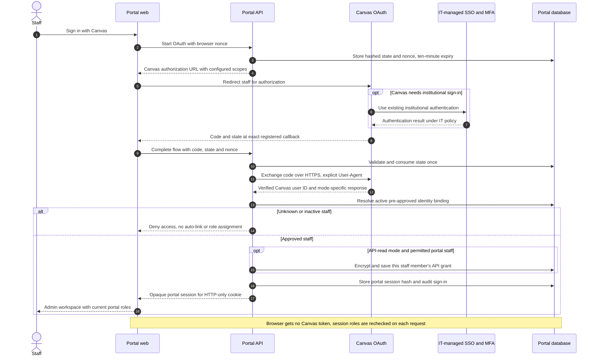

Saved staff grants remain after portal logout, but scheduled execution is deferred in this demo. Refresh is serialized, preserves an omitted refresh token and retries a Canvas 401 once after refresh. Revocation, deactivation or lost permission stops/pauses work. Disconnect removes that staff grant and pauses its schedule while preserving the portal session and saved source history. Canvas-mode configuration errors fail closed; mock identity headers/selectors cannot bypass it. See [operational details](canvas-staff-auth.md).

### Canvas previews and offering imports (implemented)

**Admin → Canvas courses** automatically reuses a valid preview or starts one read when needed. **Refresh from Canvas** reloads discovery; **Schedule settings** explains that scheduled previews are deferred. Preview filters apply to the complete inventory before pagination: title keywords, start/end date ranges (Eastern Time) and publish state. Connection and staff details are compact, expandable panels.

- API requests run the connector directly in TypeScript; local development skills and Python are not portal runtime dependencies.
- Read only published courses from the configured subaccount, optionally including descendants; validate pagination origins and ancestry. Failed/partial/suspiciously empty scans keep the last good source data. Previews are private encrypted temporary files, outside the database, with a 30-minute lifetime; durable job/audit metadata and OAuth grants remain in PostgreSQL.
- **Create offering draft** handles an unmapped row; **Refresh source details** handles a mapped row; **Import selected** handles batches. Selection across pages, retry and the Imported courses tab are implemented. Neither automatic page loading nor manual preview reads save course details or creates offerings without this explicit action.
- Import uses the server-held owned preview, current authorization, preview freshness and saved revision. One default mapping per `(installation URL, Canvas course ID)` and one target offering are database-enforced. A conflicting existing manual course link stops the batch; no title matching, silent adoption or duplicate offering creation. Mapped links cannot be removed/changed through offering edits.
- New drafts copy the Canvas title/link/valid dates and leave required sales information unset. Warnings and publication gates cover topic, summary, description, format, price, capacity mode and course type/schedule. A finite capacity is 1–10,000; explicit **Unlimited seats** stores a separate flag with null capacity. Blank capacity without that flag remains incomplete. A new finite limit must cover seats already in use.
- Imported offering cards use the Canvas course image from source metadata; absent, unsafe or failed images use the existing CU CE white logo on navy. Discovery includes `course_image` using the same GET scope. Source refresh can change/remove this URL independently of staff-owned offering fields. Staff can upload a portal image, explicitly use CU CE, or return to the source image in offering Details. Migration 020 stores that versioned, audited portal choice separately; refresh never overwrites it and image editing never changes Canvas.
- Later imports update **source metadata only**, preserving every staff-owned offering field, publication, version, price, capacity mode, dates, orders and entitlements. Portal publication never publishes/unpublishes Canvas. Listing preference is independent and retained by source refresh; availability checks against previously mapped course IDs remain planned.

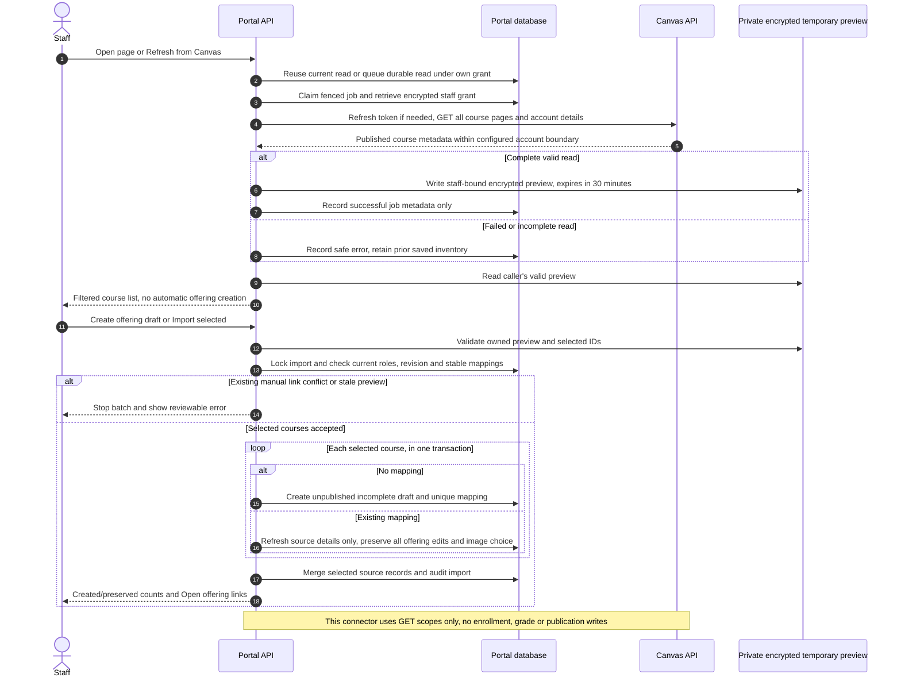

### Policy decisions

Decided October 6, 2026, and implemented in the prototype (migration `005_enrollment_policies.sql`). Each value below is a per-offering default that staff can change in **Admin → Offerings → Settings**. Changes are version-checked and audited (`offering.settings_changed`).

| Policy | Decision | Prototype behavior |
| --- | --- | --- |
| Approval validity | An approval lasts one week; staff can change the period | `approval_valid_days` (default 7, range 1–365). Approval sets `approval_expires_at`. Unused approvals lapse to `approval_expired` (authenticated API requests, audited `approval.expired`). A still-valid approval survives an expired seat reservation. A changed period applies to new approvals only |
| Enrollment window | Scheduled courses close enrollment one week after the start date; staff can change the window | `enrollment_close_days` (default 7, range 0–365). Registration, approval requests and seat renewals are refused after the start date plus that many days. Registrations already in progress are unaffected. Self-paced courses never close |
| Repeat requests | Declined learners may request approval again | Re-registering after a decline (or a lapsed approval) creates a new approval request (audited `approval.requested_again`) |
| Course launch | Learners get a link to the Canvas course once their Canvas account and enrollment exist | `canvas_course_url` (optional HTTPS). Shown as **Open course in Canvas** only after enrollment completes; returned by the API only for enrolled registrations. Sample offerings use `canvas.example.edu` placeholders, which open a "not connected yet" dialog instead of a new tab; imported offerings use stable Canvas course mappings; real learner identity/enrollment verification still awaits M4 |
| Payment (decided Oct 7, 2026) | Stripe-hosted Checkout; one Stripe Product per offering; cards and wallets only; the signed webhook alone confirms payment | Sandbox when `STRIPE_SECRET_KEY` (test mode) is set, otherwise simulated. 31-minute sessions extend the 30-minute seat hold to their expiry plus 5 minutes. [ADR 0005](adr/0005-stripe-hosted-checkout.md) |
| Tax (decided Oct 7, 2026) | The university does not collect tax on these courses | Stripe Tax off; Checkout shows no tax |
| Refunds (decided in part Oct 7, 2026) | Portal staff initiate refund requests; Finance processes refunds in Stripe; a full refund ends course access | Admin → Transactions holds requests; `charge.refunded` closes them, marks the registration Refunded and releases the seat. Partial refunds are recorded with access unchanged (still to decide) |

### Known prototype gaps

Recorded October 2, 2026, after the registration-flow verification and UI modernization. The current baseline is described in the [UI specification](prototype/ui-specification.md), and evidence is in the [implementation progress](prototype/implementation-progress.md). These are open items, not accepted behavior. Resolve or explicitly accept each one before the milestone named.

Resolved October 6, 2026: staff offering management now covers editing (drafts freely; published offerings only with an audited reason, with course type and approval requirement locked, dates locked while learners are registered and capacity never below seats in use), unpublishing with a reason, append-only price history with per-reservation quoted prices, and field-level validation with an error summary in the offering form. Unpublished offerings have their own status (`unpublished_at`, migration 007) and keep the published-offering edit rules.

Resolved October 5, 2026: My learning no longer loses keyboard focus (focus moves to the next action or the course heading); static status messages no longer use alert semantics, and background status changes are announced once through a polite live region; simulated provisioning failure, bounded automatic retries, the staff exception queue (retry or manual enrollment, each with an audited reason) and a worker crash/restart drill are in place. Screen-reader confirmation of these changes is still part of the accessibility evidence gap.

| Gap | Current behavior | Needed | Milestone |
| --- | --- | --- | --- |
| Accessibility evidence | Keyboard, focus, contrast and 320–375px reflow are checked. Automated checks run in CI (October 7, 2026): axe scans of the key pages and staff dialogs in Chrome, Firefox and WebKit, forced colors, and reflow at 320 px with 200% text and increased text spacing. No screen-reader session has been recorded; deferred on October 7, 2026, and still required | Run the [VoiceOver review script](prototype/screen-reader-review.md) and record findings before the closed pilot | M1 exit; release gate |
| Pending and declined learner messages | API behavior is verified; the browser view as the affected learner is not | Review both states in the browser as the learner | M2 |
| Catalog and staff paging | The API returns up to 100 offerings and 200 audit events; the catalog has no pagination; staff sorting and paging are client-side within those limits | Server-side search, sort and paging before catalog or audit volume approaches the limits | M2 |
| Brand baseline | Figtree, a free font similar to Proxima Nova (the cedarville.edu font), is used; colors are provisional and copy is unreviewed | Cedarville Marketing to approve Figtree as the substitute or supply a licensed brand font; approve colors, logo use and content | M1 exit |
| Theme acceptance | Manual Light, Dark and Match device choices are implemented | Finish institutional brand/accessibility acceptance | M1 |
| Authentication acceptance | Canvas-mode staff use OAuth and current server-side roles; mock mode remains a local demo option; existing-account learners can use identity-only Canvas OAuth; arbitrary email selection remains mock-only | Verify institutional Canvas authentication/MFA, remaining denial/session cases and real learner authentication before pilot | M1 |
| Exception ownership and alerting | Failed provisioning reaches a staff queue with reason, history, retry and manual-resolution actions, but exceptions have no assigned owner, age target or alert, and the simulation outcome is one shared setting for all demo users | Owner assignment, ageing/SLA indicators and alerts once staff roles exist; per-scenario simulation if concurrent demos need it | M3 |

## Scope and ownership

| System or group | Owns |
| --- | --- |
| Portal / Program Operations | Public catalog, offerings, approvals, orders, entitlements, status and support queues |
| Stripe / Finance | Hosted payment collection, receipts, refunds, disputes and financial reconciliation |
| IT Identity | CedarNet and Courtesy Accounts, SSO/MFA, activation, identity matching, expiry, disablement and retention disposition |
| Canvas Administration | Course/section mappings, SIS user mapping, enrollment permissions and learning records |
| Security / Registrar / Legal | Authentication policy, privacy, retention, age restrictions and accessibility review |

First release: non-credit offerings, self-purchase, one offering per checkout, one-time payments, optional approval, existing or Courtesy identities, verified Canvas enrollment, learner status and staff operations. Separate course products from saleable offerings/cohorts.

Defer subscriptions, group purchasing, bundles, automated transfers and LTI 1.3. Memberships, bulk enrollment and priced pathways or collections are [requested additions](#requested-feature-additions) that overlap these deferrals; they stay out of the first release unless the sponsor moves them (decision register F-series). Staff-assisted transfers still need a documented, auditable procedure before the pilot. Certificates initially link to the approved record system; do not invent a certificate issuer or retention policy.

## Requested feature additions

Requested October 7, 2026. These features extend the portal beyond the first release described above. Each lists its purpose, dependencies, risks and open decisions. Proposed milestones are in [Requested features by milestone](#requested-features-by-milestone), and the open decisions are tracked as F1–F11 in the [decision register](decision-register.md#product-features). None is approved for implementation until its decisions have owners.

| Feature | Summary | Main dependencies | Proposed timing |
| --- | --- | --- | --- |
| Enrollment and sales dashboards | Staff views of enrollment and sales trends (compared with Teachable below) | Real orders (M3) and verified enrollments (M4); Finance reconciliation | Enrollment: M4. Sales: M6 |
| Completion dashboard | Completion and progress by offering, cohort and pathway | **Canvas connection** (M4), completion evidence (R2, F11) | After the Canvas connection (M4+) |
| Customizable sales pages | Staff-edited marketing pages for offerings, pathways and collections | Brand approval (O4); content and accessibility review | After M2, before the pilot |
| Pathways | Staff-defined sequences of courses that learners follow | Catalog (M2); completion evidence (R2) for progress | Browse and follow: M2+. Progress: M4+ |
| Collections | Staff-curated groupings such as Bible Minor, Christian Leadership and ACSI | Catalog (M2) | M2+ |
| Saved courses | A learner's private favorites or wishlist (recommended instead of learner-created collections) | Learner sign-in (A4) | M2+ |
| Memberships | Monthly or yearly fee for continuing access | Stripe subscriptions; Finance, tax and refund policy; Canvas and Courtesy lifecycle | After the pilot |
| Coupons | Discount codes at checkout | Stripe Checkout (M3); Finance discount policy | M3+ |
| Bulk enrollment | Staff or organizations enroll many learners at once | Identity provisioning at scale (C1, M4); invoicing policy | After M4 |
| User exports | Downloadable learner, registration and order data | Privacy, retention and export policy (P7); staff roles | M5 |

### Enrollment, sales and completion dashboards

**Comparison with Teachable (reviewed October 7, 2026).** Teachable is the likely current platform (see migration scope O2). Its reporting is split in two:

- **Sales Analytics Dashboard:**
  - Built on Retool, a third-party tool. Only the school's primary owner can open it, and only on paid plans.
  - Metrics: sales, conversions, refunds, failed payments, subscriptions, monthly recurring revenue (24 months), churn, lifetime value, free-to-paid conversion and time to convert, total students and first-time subscription enrollments.
  - Filters by date range and product. The transactions, subscriptions and failed-payments tables export as CSV.
- **Transactions page:** CSV exports emailed to the owner, including fees, tax, refunds, earnings and payouts.
- **Per-course reports:** lesson completion, video engagement, quiz scores, leaderboards with enrollment and completion dates, and individual student progress. They filter by user tag and export as CSV.

Teachable has **no separate enrollment dashboard**; enrollment counts sit inside its sales and course reports. Its completion data exists because it hosts the course content.

**What this portal adopts from it:**

- date-range and product filters, plus offering, collection and pathway filters
- refunds and failed payments shown beside sales
- CSV export of each underlying table, under the user-export rules
- monthly recurring revenue and churn, only if memberships (F6) go ahead
- free-to-paid conversion, only if free offerings are introduced

**Where this portal deliberately differs:**

- Access is by role scope, not one owner.
- Dashboards are built into the portal, not an external tool, so permissions, audit and accessibility stay under our control.
- Completion data comes from Canvas, not the portal.

**Local reporting (updated October 14, 2026):** an Admin → **Dashboard** tab (`GET /api/v1/staff/dashboard`) demonstrates the enrollment and sales dashboards on prototype data. It has date-range and offering filters, KPI tiles, accessible single-series column charts with table views, offering tables with seat meters, CSV export of aggregates, and a completion placeholder. Sales appear only with `reports:sales`, granted to Staff administrators. Finance is an external department, not a portal role. Refunds and failed payments show as not yet available.

The dashboards:

- **Enrollment dashboard** (Program Operations):
  - New registrations, approvals pending, seats filled versus capacity, enrolled versus provisioning versus exceptions, by offering, collection, pathway and date range.
  - It can use portal data alone, but "enrolled" must mean verified Canvas enrollment (M4).
- **Sales dashboard** (Finance and Program Operations):
  - Gross sales, discounts, refunds, failed payments and net, by offering, coupon, membership and period, with first-time versus returning buyers.
  - Figures must reconcile to Stripe, which is the financial source of truth. The dashboard is operational insight, not financial evidence. Label any simulated or test-mode data.
- **Completion dashboard** (Program Operations and instructors), a **separate feature, built only after the Canvas connection** (M4+):
  - Course completion rate and completion over time, by offering, cohort and pathway.
  - Learners not yet started, in progress and complete, with time to complete.
  - Pathway progress across courses.
  - Teachable's video and quiz analytics depend on hosting the content. Canvas keeps its own learning analytics, so the portal should link to Canvas reports rather than copy lesson-level data.
  - The data source is Canvas: course completion, module requirements or grades, as decided in R2 and F11. Pull it on a schedule or through Canvas events; never infer completion from the offering end date.
  - Learner-level views follow the export privacy rules (F9) and may need instructor-specific access.
- **Access:**
  - Dashboards show aggregates.
  - Drilling down to individual learners follows the user-export rules.
  - Sales figures require `reports:sales`; the current Staff administrator role grants it. Finance works outside the portal in Stripe.
  - Enrollment and completion figures fit the existing `reports:read`. A narrower instructor scope may be needed for completion.
- **Accessibility:** charts need text alternatives and table views; colour must not be the only signal.

### Customizable sales pages

- **What:** marketing landing pages for an offering, a pathway or a collection. Offering sales pages are implemented with rich-text/media editing, structured sanitized storage, preview and revisions; collection/pathway sales-page editing remains proposed.
- **Building blocks:** use structured blocks, not free-form HTML, which would be a cross-site scripting risk and an accessibility risk. Blocks include:
  - hero with image and alternative text
  - rich text with limited formatting
  - learning outcomes
  - instructor or partner details
  - testimonials (with consent records)
  - frequently asked questions
  - price and call to action
- **Workflow:** draft, preview, then publish, versioned and audited like offerings. Published pages change only through a reviewed edit.
- **Search and sharing:** stable, readable URLs (slugs), page titles, descriptions and social-sharing images.
- **Ownership:** Marketing approves brand and content. A **Content editor** staff role (with the implemented `content:write` scope) separates page editing from catalog management: content editors cannot change prices, policies or publication.
- **Gates:** each published page passes the accessibility checklist. Prices and dates are pulled from the offering, never typed into page text, so they cannot drift.

### Pathways

- **What:** a staff-defined, ordered sequence of courses, such as Bible Foundations 1 → 2 → 3. Staff create, publish and retire pathways; learners **follow** one to see their progress and the next recommended course.
- **Decisions (F4):**
  - Does following a pathway register or charge for anything, or does each course stay a separate purchase?
  - Are earlier courses prerequisites, or only a recommended order?
  - Can a pathway have a bundled price? If so, it becomes a "bundle", which the first release defers.
  - Does completing a pathway earn a certificate? The plan says not to invent a certificate issuer.
- **Dependencies:** progress needs authoritative completion data (R2), not just enrollment. Pathways that include Scheduled courses must handle cohorts that no longer run.
- **Prototype (October 7, 2026):** pathways are collections of kind `pathway` with an ordered course list. Staff with `catalog:write` create drafts, reorder courses and publish; a published pathway needs at least two published courses. Learners follow a pathway from its public page (`/collections/{slug}`) and see it in My learning with each course's registration status. Following is free and registers nothing, and the order is a recommendation; both are F4 assumptions pending confirmation. There is no progress or completion until the Canvas connection (F11), no bundled pricing and no certificate.

### Collections

- **What:** staff-curated, published groupings for discovery and marketing, such as **Bible Minor**, **Christian Leadership** and **ACSI**. Unlike pathways, collections have no order or progress. They can appear as catalog filters and landing pages.
- **Recommendation for the open question (F3):**
  - **Collections are created by staff only**, through a reviewed publish workflow like offerings.
  - Learners get a separate, private **Saved courses** list (favorites or wishlist), not learner-created collections. Calling both "collections" would confuse people. Private lists avoid moderation and privacy work.
  - Shareable learner-created lists can be reconsidered later.
- **Prototype (October 7, 2026):** built as recommended. Staff-curated collections (draft, publish, unpublish, audited) appear as a catalog **Collection** filter, a public page and "Part of" links on course pages; unpublished courses in a collection stay hidden from learners. Learners save courses privately from the course page and manage them in My learning. Sample data: Christian Leadership, Technology at Work and the Data-Informed Leader pathway.
- **ACSI:** if a collection reflects a partner or credential, such as ACSI professional development, confirm whether it implies eligibility rules, partner pricing or reporting obligations (F5). If it does, it is more than a display grouping.

### Explore landing tab

- **What:** the catalog opens on an **Explore** tab beside the complete **Courses**, **Collections** and **Pathways** tabs. It features up to 5 courses first, then 3 pathways and 3 collections Personal next steps live in My learning instead: enrolled courses (Enrolled courses) above registrations in progress, and a **Next** marker on each followed pathway.
- **Selection:** catalog managers (`catalog:write`) and content editors (`content:write`) choose and order the picks on **Admin → Explore page**, saved as one audited change (decision F12). Empty spots fill automatically (open scheduled courses by soonest start, then the newest self-paced courses; newest collections and pathways). Only published items can be picked, and unpublishing removes a pick. Popularity ranking was rejected: with little data it is noise, and it keeps the same items on top.
- **Prototype (October 7, 2026):** built as above. A For you section on Explore was tried and removed at review; its next-step marker moved to My learning. The former hard-coded three-course spotlight was replaced; its picks were carried over as the first featured courses.
- **Open:** the pathway **Next** marker switches to completion-based progress after the Canvas connection (F11).


- **What:** a monthly or yearly fee that gives continuing access.
- **Decisions (F6):**
  - Access to what: all self-paced courses, a collection, or a library?
  - Price, trials, proration, cancellation and refund rules, and tax.
  - What happens on lapse: a grace period, then removal of Canvas access?
  - How memberships combine with one-time purchases.
- **Implementation:** Stripe Billing subscriptions with signed webhooks. Entitlements become time-bounded while a membership is active. Subscription status changes must be reconciled, as with M3 checkout.
- **Lifecycle impact:** Courtesy account expiry (P8) must treat an active membership as a protected entitlement. A lapsed membership must not disable an identity that other entitlements still need.
- **Scope note:** this reverses the first release's "defer subscriptions" and needs Finance and IT Identity approval before design.

### Coupons

- **Rules:** discount codes with percent or fixed amount, valid dates, total and per-learner limits, applicable offerings or collections, and stacking rules. Implement them as Stripe Coupons and Promotion Codes, mirrored in the portal for audit and reporting.
- **Price consistency:**
  - The quoted price at reservation records any discount, consistent with price quoting.
  - Approval-gated offerings apply coupons only at checkout.
  - A 100% discount still needs a non-payment fulfillment path with Finance-approved records.
- **Governance (F7):** Finance approves who can create coupons and the discount limits. Coupon creation and use are audited, and abuse controls include rate limits and single-use codes.

### Bulk enrollment

- **What:** enroll many learners at once.
  - **Staff-assisted:** upload a CSV of learners for an offering.
  - **Organizational purchase:** an organization buys seats for its people. This is the "group purchasing" the first release defers.
- **Processing:**
  - Validate every row first and show a per-row report before committing: duplicates, approval needs, capacity, eligibility.
  - Process each row idempotently as durable jobs. Report partial success; never apply all-or-nothing silently.
- **Identity:** each learner may need a Courtesy account. Bulk volume makes ambiguous-match handling (C1) and IT rate limits critical.
- **Decisions (F8):** payment by invoice versus card, who may bulk-enroll, seat reservation for organizations, and notification rules.

### User exports

- **What:** CSV exports of learners, registrations, orders and audit activity for staff reporting.
- **Privacy first (F9):**
  - Only roles approved by Security and the Registrar can export, for example through a new `exports:run` scope.
  - Exports carry the minimum fields, with a field selection.
  - Every export is audited (who, what, filters, row count).
  - Files are generated on demand and not stored long term.
  - Retention and handling follow P7 and institutional data policy.
- **Formats:** CSV, with spreadsheet formula injection neutralized. Large exports run as background jobs.

## Interface requirement: established open-source components

Use `@mui/material` and `@mui/icons-material`. Use MUI X **Community** components only when needed for staff grids/date inputs. Material UI is MIT licensed and provides a broad, established component system; MUI X Pro and Premium have commercial licenses. Pin compatible stable versions and retain license notices. See [Material UI repository](https://github.com/mui/material-ui), [component catalog](https://mui.com/material-ui/all-components/) and [MUI X licensing](https://mui.com/x/introduction/licensing/).

This is a deliberate design recommendation: a complete component system reduces custom styling and interaction work for the catalog, registration forms and operational tables. Do not combine competing component libraries or introduce a second styling system without an ADR.

### Visual and interaction conventions

- Begin with documented MUI layout/component patterns. Customize a shared theme using approved Cedarville colors, typography, logo, spacing and restrained surface styles. Obtain brand assets instead of inventing them.
- Use a conventional university course catalog: clear navigation, category/search controls, readable course listings and prominent price, dates, eligibility and enrollment action.
- Use compact tables and filters for staff work. Show operational counts only when they help staff act; no decorative charts or generic dashboard tiles.
- Avoid gradient backgrounds, glass effects, oversized rounded cards, floating decorative shapes, emoji navigation, excessive animation and generated hero illustrations. Use approved course imagery only when it conveys useful information.
- Prefer text labels such as “Request approval,” “Continue to payment,” “Payment received,” and “Open course.” Display the next action, support contact and expected timing beside the status.
- Keep forms short, with visible labels, inline validation and an error summary. Preserve entered data after recoverable errors. Explain approval requirements before sign-in or payment.
- Cover loading, empty, validation, permission-denied and service-failure states. Production must not show verified “Enrolled” until Canvas enrollment is confirmed; the local prototype instead labels its identity/enrollment simulation and records simulated audit events.
- Use responsive layouts, visible focus, keyboard navigation, accessible names, text plus color for status and reduced-motion support. Meet the source baseline of WCAG 2.1 AA; confirm whether institutional policy requires a newer standard. Library choice alone does not establish compliance.

### Screen inventory and components

| Screen | Required content | Library patterns |
| --- | --- | --- |
| Catalog | Search, categories, availability, prices and dates | AppBar, Container, TextField, Select, List or restrained Card, Pagination |
| Course detail | Outcomes, prerequisites, schedule, price, approval/refund rules | Typography, Stack, Divider, Alert, Button |
| Sign-in and linking | Staff: Canvas OAuth with portal sessions; learners: mock email selection, future verified authentication/linking | TextField, Button, Alert; authentication-provider flows |
| Registration | Required identity fields, approval status, seat hold | Form controls, Stepper where useful, validation summary |
| Order/access status | Payment and enrollment shown separately, timing, support | Alert, List, progress indicator, actionable links |
| My learning | Offerings, access status, dates, approved record links | List or Table, Chip, Button |
| Offering administration | Draft warnings, explicit Unlimited seats, publish/unpublish, audited edits and price history; live section validation remains planned | Table or Community DataGrid, forms, Dialog |
| Canvas courses (implemented) | OAuth connection, preview filters, row/batch imports, linked drafts, imported inventory and scheduled preview settings | Table, Checkbox, filters, Alert and expandable panels |
| Approvals/exceptions | Filters, owner, age, evidence and permitted actions | Table or Community DataGrid, Drawer, Dialog, Alert |
| Reconciliation/lifecycle | Unmatched records, proposed changes, audit trail | Table, date inputs, CSV export, confirmation Dialog |
| Dashboards (local reporting implemented) | Enrollment and sales trends, filters, table alternatives to charts | Cards, Table, date inputs; MUI X Charts (Community) only with an ADR |
| Sales page editor (offerings implemented) | Structured blocks, preview, publish, version history | Forms, Dialog, Stepper or Tabs; no free-form HTML |
| Pathways and collections (browse/follow implemented) | Ordered or curated course lists, follow and progress, saved courses | List, Card, Chip, Stepper (pathway progress) |
| Explore tab (built in the prototype) | Staff-picked courses, pathways and collections with automatic fill | Tabs, Card |
| Coupons (requested) | Code rules, limits, usage | Table, forms, Dialog |
| Bulk enrollment (requested) | CSV upload, per-row validation report, job progress | File input, Table, Alert, progress indicator |
| Exports (requested) | Dataset and field selection, audit notice, download | Forms, Alert, Button |

Before full UI development, review catalog, course detail, learner status and staff exception screens using realistic sample data at mobile and desktop sizes. Acceptance requires brand consistency, recognizable library patterns and successful keyboard completion of the main tasks.

## Architecture and implementation boundaries

The implemented local architecture is a single domain context with a NestJS API processing durable work during requests, a Next.js/React website with MUI, and PostgreSQL managed through Prisma Migrate. Services bind to loopback on 3050/3051, with PostgreSQL on 5433. Production hosting, real learner authentication, IT identity contracts and production operational ownership remain unresolved. Staff Canvas OAuth and read-only Canvas metadata access are implemented; neither requires a separate portal-to-SSO adapter or a deployed local skill.

NestJS supports [OpenAPI documentation generation](https://docs.nestjs.com/openapi/introduction) and [API versioning](https://docs.nestjs.com/techniques/versioning). MUI documents its [Next.js integration](https://mui.com/material-ui/integrations/nextjs/). The framework split keeps the automation interface independent of website pages, at the cost of separate web and API runtime processes. Deploy them from one repository and route browser API traffic through the same origin where practical.

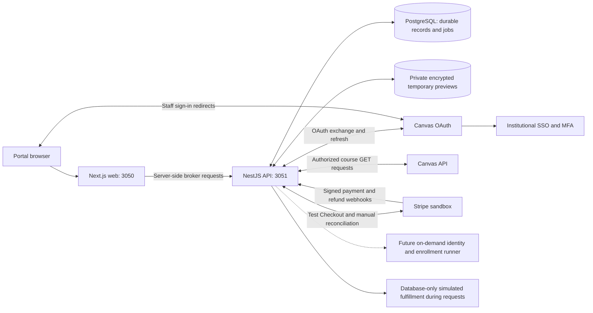

Solid edges describe implemented integration boundaries. Dashed edges indicate future capabilities, not configured services. Canvas uses institutional SSO upstream; the portal integrates with Canvas OAuth. Source previews are temporary files written and read by the API, while saved source/mapping records are in PostgreSQL. Identity/enrollment simulation never calls institutional provisioning or Canvas enrollment APIs.


Current repository structure:

```text
CONTEXT.md                 # Glossary, invariants, ownership
docs/adr/                  # Accepted architecture/policy decisions
docs/runbooks/             # Recovery, reconciliation and rollback
src/web/                   # Next.js website, MUI screens and shared theme
src/server/                # NestJS REST API, authorization, integrations
src/domain/                # Offerings, approvals, orders, entitlements
src/server/demo-processing.ts # Request-driven simulated fulfillment and expiry
tests/                     # Domain, integration and browser checks
```

All privileged actions execute on the server with role and record-level authorization. Browser state, Stripe metadata and email addresses never establish ownership or payment authority by themselves. Public catalog responses exclude learner and identity data.

### API and automation support

API support is a first-release architecture requirement, not a later retrofit. Business actions live in shared application services called by API handlers and workers. The website consumes these contracts; any server-rendering or authentication adapter must preserve the same authorization and business rules. Automation never writes directly to the database or simulates UI clicks.

Use versioned REST/JSON endpoints under `/api/v1`, a generated OpenAPI specification at `/api/openapi.json`, and interactive API documentation in approved environments. Define request/response schemas, permissions, error codes, pagination/filtering and examples alongside each workflow. The website currently uses a typed fetch wrapper; a generated client and Python/command-line examples remain future automation work. No GraphQL or custom SDK is required initially.

| Capability | Implemented API or explicitly planned example | Boundary |
| --- | --- | --- |
| Read catalog and availability | `GET /api/v1/offerings` | Public responses exclude personal data |
| Create/update/publish offerings | `POST /api/v1/offerings`, `POST /api/v1/offerings/{id}/edit`, `POST /api/v1/offerings/{id}/publish`, `POST /api/v1/offerings/{id}/image` | Offering-management permission; normal validation and audit |
| Read and decide approval requests | `GET /api/v1/approval-requests`, `POST /api/v1/approval-requests/{id}/decision` | Scoped approval authority; preserve any required human review |
| Read orders and access status | Current: `GET /api/v1/staff/transactions`, `GET /api/v1/me/learning`; broader machine contracts planned | Restricted record visibility; cannot set payment status manually |
| Queue approved operational work | Implemented: `POST /api/v1/exceptions/{id}/retry`; transfers planned | Same policy, capacity, sponsorship and authorization checks as staff UI |
| Check asynchronous outcomes | `GET /api/v1/operations/{id}` | Return pending/running/succeeded/failed and safe error detail |
| Export reconciliation data | `GET /api/v1/reconciliation` | Restricted reporting scope, bounded queries and minimal personal data |

The implemented routes are authoritative in generated OpenAPI; table entries explicitly marked planned are not available. Course discovery/import uses the staff-authorized routes documented in [Canvas courses](canvas-courses.md). Provisioning follows a valid paid entitlement; there is no unrestricted enroll-user, disable-account or mark-order-paid endpoint. Finance continues initiating refunds through Stripe; the implemented API exposes permitted refund status/requests without changing that ownership.

Production machine clients still need dedicated service identities with short-lived tokens, narrow permissions, revocation and audit attribution. The local prototype currently uses ignored broker tokens and a read-only automation profile; it has no production machine OAuth provider. Prefer OAuth 2.0 client credentials through an approved provider; verify provider support in M0. Staff browser users use the implemented Canvas OAuth and portal session flow; learners still use mock selection pending an approved provider. Define scopes such as `catalog:write`, `approvals:decide`, `orders:read`, `exceptions:retry` and `reports:read`, together with offering/program restrictions. A service identity does not impersonate a learner or bypass fresh-sign-in requirements.

Mutating workflow commands support idempotency keys, with key/request matching and documented retention. Use resource versions or conditional updates to prevent accidental overwrites. Long-running actions return `202 Accepted` with an operation ID and status URL, not a premature success message. Document rate limits, retry guidance and stable error responses. Audit both the calling service and the initiating actor when applicable.

A general outbound transactional outbox is not implemented. Current commands, audit records, Stripe events and background operations use database transactions. Add an outbox when outbound integrations are implemented. Add signed outbound webhooks when automation integrations are introduced, with events such as `offering.published`, `approval.decided`, `order.paid`, `enrollment.verified` and `exception.opened`. Delivery is at least once: include event ID, schema version and timestamp; persist delivery attempts, use bounded retries and support authorized replay. Subscribers deduplicate and can query the API for current state. Minimize webhook personal data and validate configured destinations. Outbound automation notifications are separate from inbound Stripe webhooks.

M1 establishes API documentation, authorization and operation-status conventions. M2–M5 implement workflow endpoints with their corresponding UI. Before pilot release, demonstrate one scoped machine client reading offerings and performing an authorized sandbox action, including denied scopes, duplicate-command retries and asynchronous failure handling. Outbound subscriber management and webhook delivery can follow when needed without redesigning the domain model.

### Domain records and invariants

The [current database ERD](prototype/database-erd.mmd) includes the actual scalar fields and enforced foreign keys through migration 020. Staff sessions and encrypted Canvas API grants are distinct records; live learner identity links below remain planned.

| Record | Key fields / constraints |
| --- | --- |
| Learner | Current internal ID and normalized mock email; verified contact/authentication accounts remain planned |
| Staff identity/session/grant | Implemented provider/origin plus Canvas user ID, active portal roles, hashed session and separately encrypted staff API grant |
| Learner identity link | Planned: durable university ID, type, sponsorship evidence, SIS mapping and uniqueness |
| Offering | Current description fields, price/history, dates/type, finite or Unlimited capacity, portal-owned image override, approval rule, protected Canvas mapping and independent portal publication; reusable product normalization remains deferred |
| Canvas course source/mapping | Current per-configuration saved inventory; unique installation/course-ID mapping to one offering, raw source metadata and timestamps; preview details remain temporary until explicit import |
| Approval | Learner/offering, decision, actor, decision time, validity window |
| Seat reservation | Learner/offering, Checkout Session, expiry, reserved/consumed/released state |
| Order / order event | Price snapshot, Stripe identifiers, append-only payment/refund/dispute events; derived current status |
| Entitlement | Learner/offering access justification, lifecycle state and enrollment reference |
| Integration event / job | Unique event and operation keys, attempts, next retry, outcome, correlation ID |
| Audit / exception | Actor, action, object, timestamp, reason, owner and resolution; exclude secrets |

Enforce atomic bounded-capacity reservation and one entitlement row per learner/offering; a fully refunded row can be reused for a later purchase with a new order. Unlimited capacity removes only the seat limit. Different Stripe event IDs concerning the same session must still result in one fulfillment. Keep payment, entitlement and identity states separate. A university identity is linked only through an approved proof process, including SSO for an existing identity.

## Corrections and decisions required from v2

| Source assumption or gap | Implementation treatment |
| --- | --- |
| Canvas Catalog is not actively maintained | Remove that unsupported rationale. Instructure currently offers [Canvas Catalog](https://www.instructure.com/canvas/catalog). **Decided October 6, 2026:** Catalog does not fit the program's requirements; build the custom portal ([ADR 0003](adr/0003-custom-portal-not-canvas-catalog.md)). The specific unmet requirements are still to be recorded in the ADR. |
| A 30-minute hold always guarantees a paid seat | Use atomic capacity allocation and Stripe session reconciliation. Disable delayed payment methods for the initial pilot. A later delayed-payment release must retain capacity while processing or define a Finance-approved exception/refund policy. |
| Browser cancellation releases a seat | A return/cancel page is not authoritative. Release only after confirmed expiration/cancellation semantics; reconcile sessions if webhooks are delayed. Stripe supports expiration from 30 minutes to 24 hours and sends an expiration event. See [Stripe inventory guidance](https://docs.stripe.com/payments/checkout/managing-limited-inventory). |
| Email code cannot be used on another device | Bind the code challenge to the requesting browser/session and enforce attempt limits. A code alone does not establish that property. Have Security approve recovery and account-linking behavior. |
| 14-day warning plus 7-day withdrawal grace | These defaults conflict for immediate withdrawal. Obtain an explicit expedited-notice rule or a longer grace period; do not silently implement both. |
| Expiry includes only Enrolled/Completed entitlements | Include paid provisioning obligations in the protection rule so a second purchase awaiting SIS cannot trigger premature disablement. IT must approve the exact state/date calculation. |
| Refund always revokes access | Distinguish full, partial, pending and failed refunds. Finance/Program Operations define which changes revoke access; dispute-open and dispute-lost are separate decisions. Handle reversal while provisioning is still pending. |
| Offering end means Completed | Track entitlement end separately from academic completion or certificate eligibility. Obtain completion evidence from the approved learning record system. |
| Canvas access removal deletes enrollment | Select and test the appropriate enrollment state with Canvas Administration; retain required records and avoid deletion by default. |
| SIS every two hours, eight-hour escalation | Treat these as planning assumptions pending IT verification. Make timings configurable and publish only an approved learner-facing expectation. |

## Portal workflows

Workflows 1–9 cover recurring offering administration, learner registration/access and ongoing operations. The staff OAuth and Canvas preview/import diagrams above are implemented workflows in addition to these numbered flows. They include actions performed by learners, staff and connected systems; the portal does not perform every step itself. For example, Finance initiates refunds in Stripe, IT provisions identities, and the portal tracks and coordinates the resulting changes.

Each workflow states whether it is implemented, simulated or a planned live target. Do not infer implementation or production acceptance from a target diagram. Solid arrows are requests/actions; dashed arrows are responses or notifications. The Portal includes server-side authorization and domain logic; the Worker performs durable background work. Every staff action requires its authorized role. Policy-dependent branches remain subject to the decisions above. The one-time course migration and launch process appears in the separate project section after these diagrams.

| Workflow | Portal area | Related milestone |
| --- | --- | --- |
| 1. Publish an offering (implemented; live mapping health planned) | Offering administration | M2 |
| 2. Existing-account learner Canvas OAuth; guest workflow planned | Learner registration and access | M1, M4 |
| 3. Approvals implemented; pre-payment institutional proof planned | Learner registration and access | M2, M3 |
| 4. Sandbox checkout, webhook confirmation and seat release | Learner registration and access | M3 |
| 5. Simulated provisioning; live Courtesy/Canvas access planned | Learner registration and access | M4 |
| 6. Refund requests/reversal implemented; withdrawals/disputes planned | Ongoing operations and support | M5 |
| 7. Staff-assisted transfer (planned) | Ongoing operations and support | M5 |
| 8. Courtesy lifecycle (planned) | Ongoing operations and support | M5 |
| 9. Stripe/simulated recovery implemented; institutional reconciliation planned | Ongoing operations and support | M6 |

### Offering administration

This is normal staff use of the portal, whether publishing a migrated course or a newly created course. It does not move course content into Canvas.

#### 1. Publish an offering

**Implemented:** staff complete the offering Details, then publish with the offering-management permission and version guard. Imported source title/link/dates do not make a draft complete. Publication currently performs no live Canvas course/section health check and creates no Stripe Product/Price; Stripe setup happens when Checkout is first opened.

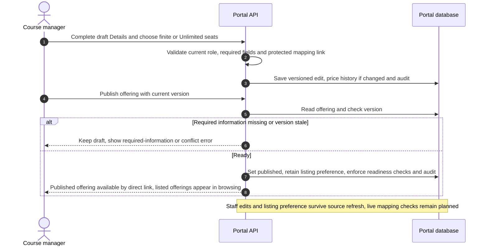


### Learner registration and access

These workflows take a learner from portal sign-in through eligibility checks, payment and verified course access. Staff approvals and IT provisioning are part of that recurring journey.

#### 2. Learner sign-in and university identity linking

**Current implementation:** `LEARNER_AUTH_MODE=canvas` uses the existing Canvas developer key and callback with `/auth/userinfo` only. Bind a portal learner to the Canvas origin and verified user ID; create one learner profile on first login without creating a CU account. Staff can independently sign in as learners without changing staff roles or sessions. Email is not returned or verified by this flow, and old demo registrations are never adopted by email. Mock mode remains local-only. See [ADR 0009](adr/0009-canvas-learner-login.md).

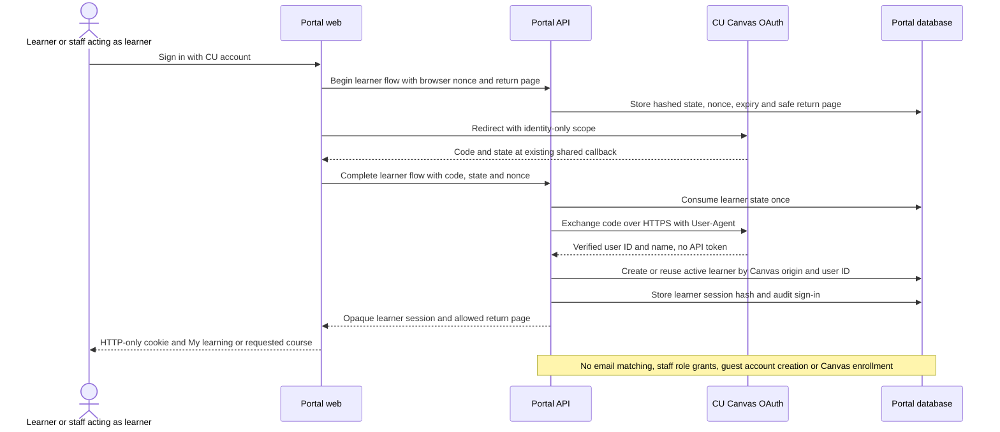

**Future guest target only:** learners without a CU account register for a course and pay before Cedarville guest account creation. The pre-account authentication/recovery and institutional provisioning contracts are deferred. The older target below illustrates possible identity controls; it does not authorize selecting a provider or implementing account creation. Existing-account login no longer depends on those decisions.

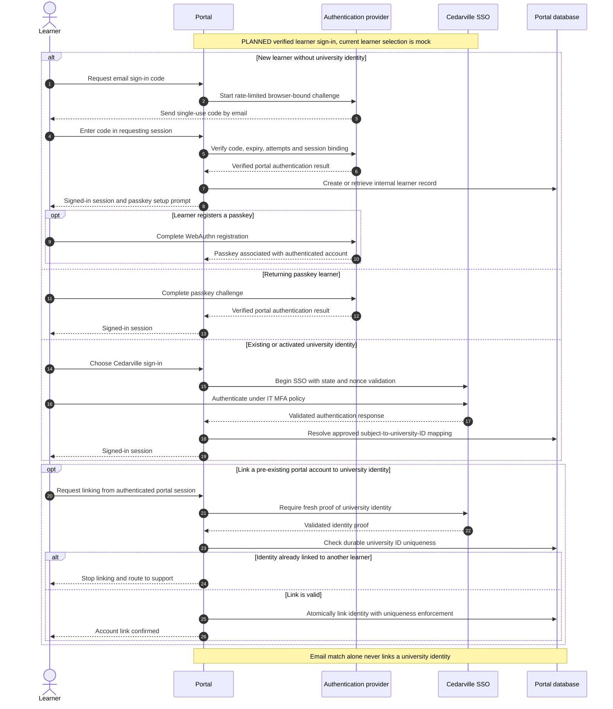

#### 3. Approval and pre-payment identity checks

**Implemented:** approvals do not reserve seats, can expire and can be requested again after decline/expiry. Registration rechecks publication, required offering data, approval validity and enrollment window; finite pools reserve capacity atomically, while Unlimited removes only the seat limit. Institutional pre-payment identity matching and fresh learner proof remain planned for M4; the current payment path does not provide them.

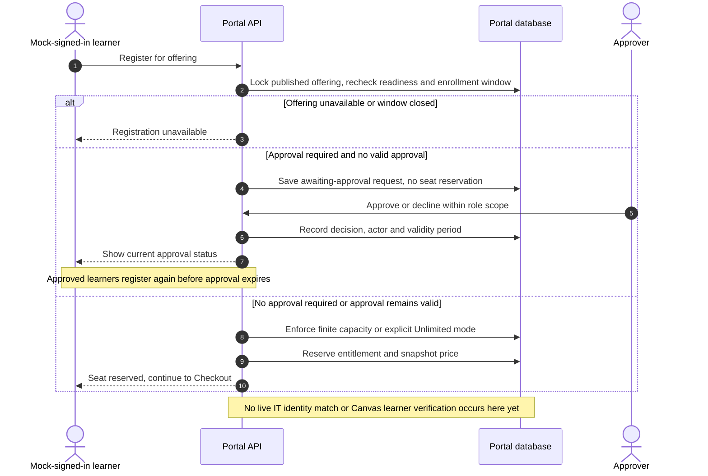

#### 4. Checkout, payment confirmation and seat release

**Implemented in Stripe test mode:** registration reserves the entitlement first; Checkout requires that current reservation and a still-published offering. Product/Price creation or reuse happens at Checkout, not publication. A signed webhook applies payment and completes normal simulated fulfillment within one database transaction. No general event-processing worker is required before payment is recorded.

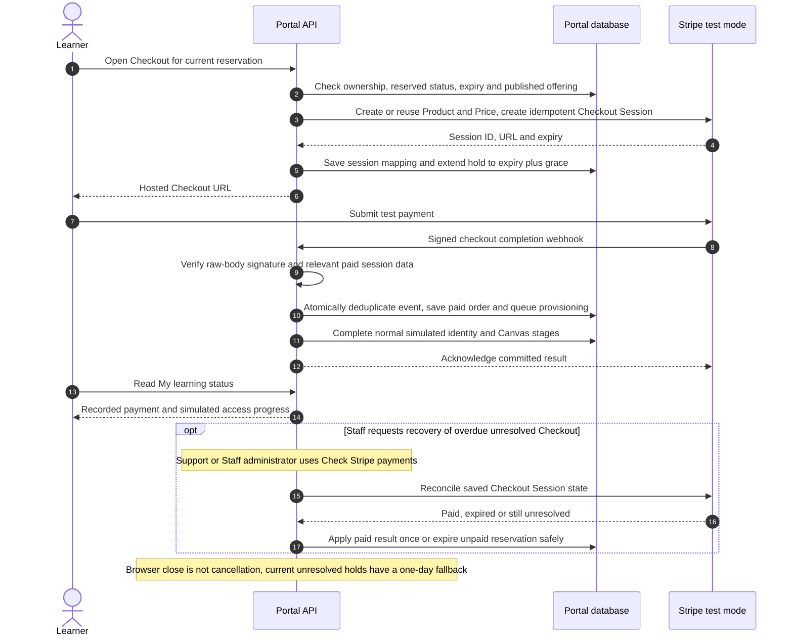

Cards/wallets are enabled; delayed payment methods and automatic recovery are not part of the current Checkout setup. The Stripe CLI listener forwards selected events or `--all-snapshot` to port 3051; its signing secret belongs in ignored `.env`. Session creation currently makes Stripe calls within a database transaction. Request-driven expiry preserves unresolved Checkout holds until one day after session expiry, then its local fallback can release them; that fallback needs explicit policy agreement and failure-path testing. Interrupted creation after remote success, full reconciliation failure paths and restart recovery need the additional drills in [next steps](next-steps.md); the diagram does not claim those production gates are complete.

#### 5. Courtesy provisioning and Canvas access

**Current implementation:** identity and Canvas stages are request-driven simulations with bounded retries, delayed/failure injection, exceptions and audited staff retry/manual-resolution actions. They make no institutional provisioning, SIS or Canvas enrollment calls. An enrolled prototype status is not evidence of a real Canvas enrollment.

**Planned live target below:** existing university identities will skip Courtesy provisioning. Real activation and Canvas enrollment must be tracked independently under the approved IT contract. No existing staff OAuth read grant authorizes this future write workflow; its permissions and identity design require a separate decision.

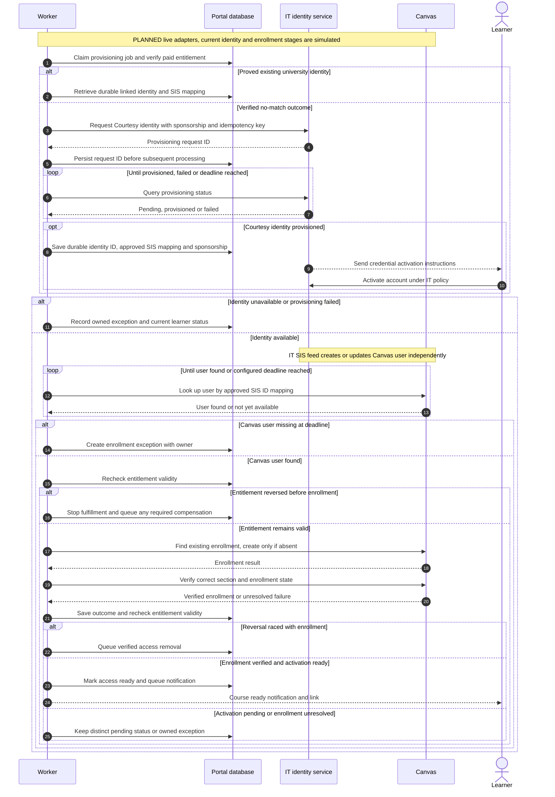

### Ongoing operations and support

These workflows manage changes and failures after registration. They remain portal operational workflows even when authorized staff or external systems perform some steps. Reconciliation in workflow 9 is ongoing payment/access checking, rather than a project migration check.

#### 6. Refund, withdrawal or dispute

**Implemented sandbox behavior:** Support or Staff administrators record portal refund requests, and the external Finance department processes refunds in Stripe. Signed `charge.refunded` updates order/refund records; full refund reverses the portal entitlement and stops further simulated provisioning, while partial refund leaves portal access unchanged. A full refund permits a later purchase with a new order. No portal Finance role, real Canvas access removal, self-service learner withdrawal or approved dispute automation exists yet.

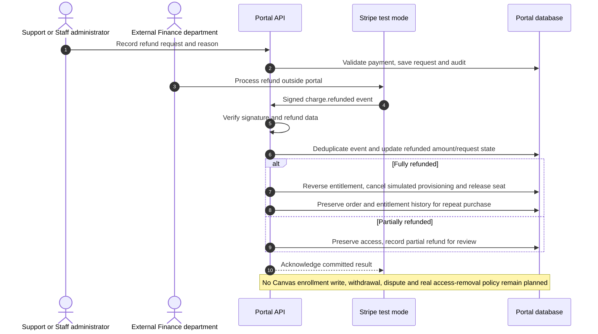


#### 7. Staff-assisted transfer

**Planned only; no transfer endpoint or live Canvas transfer is implemented.** Transfers require a defined recovery strategy across two Canvas sections. Keep original access until target enrollment is verified; if source removal fails, record temporary overlap as an exception rather than silently declaring success. Finance decides any price adjustment separately.

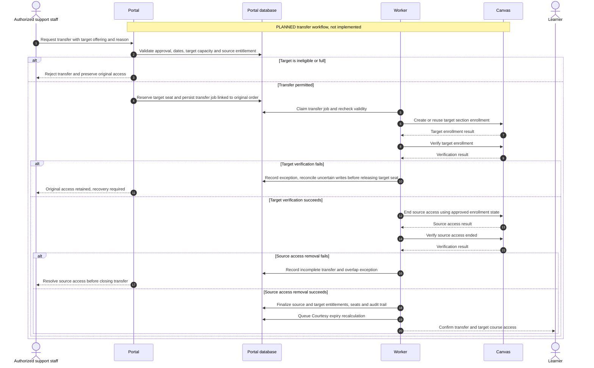

#### 8. Courtesy expiry, notices and disablement

**Planned only; no institutional lifecycle scheduler is implemented.** The future lifecycle design recalculates expiry after entitlement changes and checks it on a scheduled job. Existing CedarNet accounts are excluded. Protection against concurrent purchases must be part of the IT contract, not just a local check performed before a remote request.

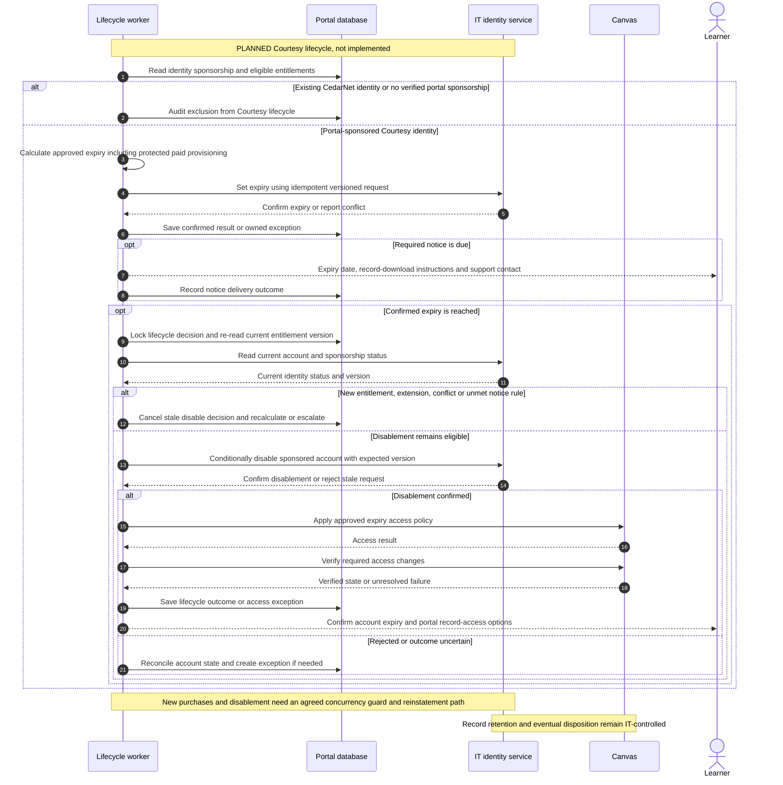

#### 9. Reconciliation and exception recovery

**Implemented:** the API handles manual reconciliation of saved Stripe Checkout Sessions and request-driven simulated provisioning/retries. The staff exception queue supports scoped, audited retries and recording a manual outcome. Those prototype outcomes do not verify institutional identity or Canvas access. Owner assignment, alerting, live identity/enrollment reconciliation and operational runbooks remain planned.

**Planned broader target below:** reconcile authoritative institutional state before retrying remote writes; manual Canvas enrollment follows an approved Canvas Administration procedure.

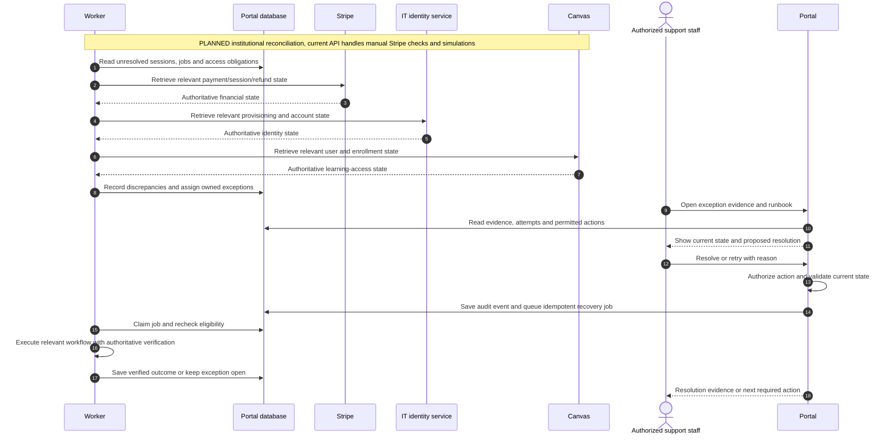

## Project migration and cutover

This section describes the project team's transition process, not a portal feature or automated portal workflow. It applies only if replacing an existing course platform is confirmed in scope and runs alongside portal development.

Here, **migrate** means transferring or rebuilding existing lessons, files, videos, quizzes and assignments in Canvas, then verifying that they work. Learner accounts, grades, completion records and certificates require separate decisions about transfer or preservation; moving course content does not automatically move those records. **Cutover** means switching the approved learner entry points to the new portal and Canvas setup.

### 10. Course migration and cutover

**Planned project process, not an automated portal feature.** Related milestone: parallel migration workstream. Course-owner QA and cutover approval precede learner redirection or source-platform retirement. Publishing offering mappings uses portal workflow 1; content migration and launch approval remain project responsibilities.

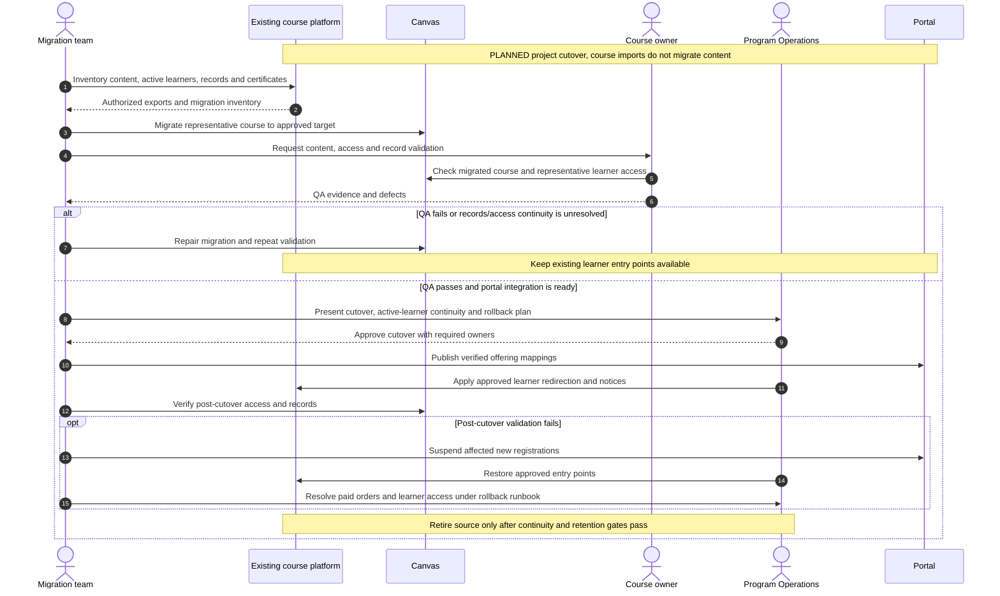

## Delivery sequence

Milestones are dependency based, not promised dates. Staff OAuth and Canvas source discovery/import were implemented ahead of the live learner-enrollment milestone. Current implementation summaries below are separate from remaining acceptance gates; the IT learner identity/enrollment contract remains the main dependency for live fulfillment.

### M0 — Establish decisions and contracts

Owners: portal lead, Program Operations, IT Identity, Canvas Administration, Finance and Security.

Deliver the domain glossary; ADRs for build-versus-buy, UI library, backend/hosting, authentication and job persistence; identity API mock and versioned contract; approved Canvas mapping; and a decision register with owner/due date (maintained in [docs/decision-register.md](decision-register.md)). Confirm approval, capacity, tax, refund/dispute, age, retention, expiry and recovery policies.

Identity contract covers `findIdentity`, asynchronous Courtesy provisioning/status, setting expiry earlier or later, identity status, disablement and reinstatement. Include idempotency, error taxonomy, ambiguous-match handling, least-data responses and proof of portal sponsorship. Permanent deletion is not a portal operation.

Exit: mocks and isolated environments permit development; every production blocker has an owner. Policy decisions may remain open for sandbox work.

### M1 — Foundation and interface baseline

**Implemented locally:** application/migrations, environment guards, shared MUI theme, role/record checks, audit and CI checks; configurable Canvas OAuth staff login with protected sessions and grants. Canvas delegates to IT-managed SSO/MFA upstream; the portal does not implement direct staff SAML/OIDC or a separate password system.

**Remaining:** approved real learner authentication/recovery, institutional staff MFA assurance, remaining live/session cases, brand approval and manual screen-reader acceptance. Mock staff mode remains an explicitly selected local demonstration mode; it is disabled as a bypass when Canvas mode is selected.

Deliver the four representative screens above with mock data, sign-in/linking spike and seeded offerings. Pin dependency versions after compatibility checks.

Exit: approved visual baseline; browser checks cover learner/staff access isolation, keyboard flow and mobile layout. No custom form, menu or dialog interaction replaces an available library component without a documented reason.

### M2 — Catalog, offerings and approvals

**Implemented locally:** draft/publish/unpublish, course browsing/search, schedules, quoted prices and append-only price history, approval expiry, protected imports/mappings, required-field warnings and explicit Unlimited seats. Publication checks required portal data and version; it does not contact Canvas or Stripe.

**Remaining:** source availability/section-health gates and explicit existing-offering linking/remapping. These must be added before claiming live mapping validation on publication or payment. Listed/unlisted visibility is implemented; see [ADR 0010](adr/0010-independent-offering-visibility.md). Portal dates belong to staff and are not overwritten by later Canvas discovery.

Deliver learner requests, staff approval queue and decision notices. Audit price, mapping, capacity, publication and approval changes.

Exit: authorized staff publish and manage an offering without code changes; approval-gated checkout is denied until a valid approval exists. Publishing a new price preserves existing Checkout Sessions.

### M3 — Sandbox checkout and durable fulfillment

**Implemented:** sandbox Checkout, bounded/unlimited capacity mode, quoted reservations, signed payment/refund events and durable simulated fulfillment. **Remaining production requirement:** verify institutional identity/matching before payment, then atomically allocate bounded capacity. Create Stripe Products/Prices and Checkout Sessions server-side using idempotency keys. Persist reservation-to-session mapping; recover interrupted session creation without leaking seats.

Verify webhook signatures against the raw request body. Commit the received event and durable work atomically, acknowledge promptly and fulfill only after authoritative payment confirmation. Use unique Stripe event IDs plus session/operation constraints. The return page reads server status.

Reconcile expired and paid sessions before releasing capacity; do not release merely because local time elapsed while Stripe outcome is unknown. Disable automatic Checkout recovery unless recovered sessions repeat availability/approval checks. Retry uncertain network outcomes using the same operation key.

Exit: concurrent checkout for the last seat cannot oversell; duplicate/out-of-order deliveries and worker crashes do not duplicate orders or jobs; expired sessions free seats safely. Validate behavior against [Stripe fulfillment guidance](https://docs.stripe.com/checkout/fulfillment) during implementation.

### M4 — Identity, Canvas and learner status

**Implemented source-read slice:** the existing staff OAuth client/callback authorizes paginated course/account reads, nested subaccounts, encrypted grants, private on-demand previews and explicit imports into protected offering drafts. It does not implement learner records or Canvas enrollment.

**Remaining live fulfillment:** replace the simulated identity/Canvas enrollment adapters with approved services after learner authentication, sponsorship, SIS mapping and write-permission decisions. Start against mocks, then isolated test services. Request a Courtesy identity only for a proved no-match outcome. Persist request ID and sponsorship; handle asynchronous activation separately from Canvas enrollment.

Look up Canvas users by confirmed SIS mapping, retry with bounded backoff and raise owned exceptions at the configured deadline. Verify an existing enrollment before retrying uncertain writes. Recheck entitlement validity before and after external operations; reversal during provisioning triggers compensating access removal without duplicate identity creation.

IT sends credential activation messages. The portal sends order/access messages and shows payment, activation and enrollment status distinctly. A ready-course link requires the appropriate verified access/activation status.

Exit: one paid test order produces one verified enrollment, delayed SIS and activation are visible, and unrecoverable failures enter an owned queue. Existing CedarNet accounts are never modified.

### M5 — Reversals, lifecycle and support operations

Implement approved full/partial refund and dispute rules, staff-assisted withdrawals/transfers, reconciliation and safe job retry. Transfers reserve target capacity and coordinate enrollment changes as a recoverable workflow; never discard original access without a recovery path.

Calculate Courtesy expiry from approved eligible entitlements, including protected paid provisioning obligations. Use compressed dates in tests. Before disablement, re-read current entitlements and sponsorship, detect concurrent purchases and conflicting IT updates, send required notice and retain an audit record. IT enforces the sponsorship boundary independently. Existing CedarNet identities have no portal lifecycle.

Current implemented portal roles are Approver, Course manager, Support, IT/Canvas administrator, Staff administrator and Content editor. Finance is external and works in Stripe; it is not a portal role. Sensitive retries and lifecycle actions require reason, preview and scoped authorization. Support must resolve normal exceptions without direct database edits.

Exit: test reversals preserve records, recalculate expiry correctly and cannot disable reused identities. Retention disposition remains IT-controlled. Learner records remain accessible through the approved post-disablement authentication method.

### M6 — Operational readiness and closed pilot

Deliver dashboards/alerts for webhook failures, queue age, provisioning delays and unowned exceptions; daily paid-versus-enrolled and sponsorship reconciliation; secret rotation, backup/restore and deployment runbooks. Finance/Security confirm payment compliance and privacy requirements rather than inferring them from hosted Checkout alone.

Run one low-risk offering with a small cohort after production gates pass. Exercise lifecycle expiry in the isolated environment; monitor the real pilot through offering completion before broader release.

Exit: all criteria below pass and Program Operations, IT Identity, Canvas Administration and Finance approve results.

### Requested features by milestone

These placements are proposals, not commitments. Each feature starts only after its F-series decisions have owners.

- **M2+ (catalog extensions):**
  - staff-curated collections
  - learner saved courses
  - pathway browse and follow, without progress
  - customizable sales pages, after brand approval (O4)
- **M3+:** coupons, after Finance discount policy (F7).
- **M4+:**
  - pathway progress, once completion evidence (R2) is approved
  - enrollment dashboard on verified enrollments
  - **completion dashboard**, built only after the Canvas connection is live and the completion source (R2, F11) is approved
- **M5:** user exports, after privacy approval (F9).
- **M6:** sales dashboard, reconciled to Stripe.
- **After the pilot:**
  - memberships (F6)
  - bulk enrollment and organizational purchasing (F8)
  - any priced pathway or collection bundles (F4)

  These revisit first-release deferrals and need sponsor approval.

### Parallel workstream — Existing course migration

If Teachable or another catalog is being replaced, begin inventory and representative-course migration during M0. Verify this scope and staffing with Program Operations; older planning dates are not release commitments. Inventory content, learner records, certificates, active enrollments, rights and dependencies. Map offerings to Canvas, migrate representative content and conduct course-owner QA independently of portal integration.

Do not redirect learners or retire the source platform until content, access, records and support continuity are verified. Preserve a rollback path and distinguish historical-record migration from new paid enrollment.

### Course schedule types

Implemented for the local prototype. Support two explicit offering types: cohort courses have scheduled start/end dates; learn-on-your-own courses start anytime and have no cohort dates. Keep course type separate from delivery format, enrollment windows and access-duration rules. Catalog cards, spotlight, course details and learner records must use the appropriate schedule label. Staff choose the type before entering dates; API and database validation reject missing cohort dates or cohort dates on an anytime course.

## Verification and release gates

| Area | Required evidence |
| --- | --- |
| Interface | Brand review; desktop/mobile screenshots; functional verification of changed workflows |
| Accessibility | Required in each UI review using the README review/test checklist; keyboard/focus, names/labels/semantics, contrast, targets, reflow/zoom and announcements; automated scan plus manual screen-reader review of registration, sign-in, errors, dialogs and staff tables before release; record unresolved findings and unperformed checks |
| Authorization | Staff Canvas OAuth binding/state/session/CSRF and role isolation; portal permission plus Canvas permission plus GET scope checks; live MFA/deny/revocation cases; verified learner linking/recovery cannot claim another identity |
| Canvas source/import | Full pagination and account boundary, owner-specific grants, deferred scheduling, revocation behavior, private-preview expiry, stale/concurrent import protection, duplicate conflicts, staff-edit preservation, publication independence and missing-field gates; independent visibility is covered by the visibility suite and mapping health remains planned |
| Payments/capacity | Success, decline, abandoned/expired checkout, final-seat concurrency and explicit Unlimited registration, safe return to finite capacity, duplicate/out-of-order webhook, crash/replay and unavailable Stripe reconciliation |
| Provisioning | Ambiguous identities blocked before payment; existing identity reused safely; asynchronous IT/SIS delays; uncertain enrollment response and retry; reversal during provisioning |
| Reversals/lifecycle | Full/partial/failed refund, dispute outcomes, transfer recovery, new purchase near expiry, notice rules, protected provisioning and existing-identity immunity |
| Operations | Restore drill, job recovery, tested alerts, owner assignment, Finance reconciliation and manual-enrollment procedure |
| Migration | Course-owner content/access/record QA and explicit source-platform cutover approval, if applicable |

Pilot metrics: every paid learner is enrolled within the approved deadline or has an owned exception; no duplicate identities/enrollments; no unauthorized identity changes; no unexplained financial or access reconciliation differences; all tested reversals follow approved policy; support resolves normal exceptions through the staff interface. An owned exception is an escalation success, not an enrollment success—report these rates separately.

Production blockers: approved identity/authentication contract, live SIS timing/mapping, lifecycle and notice rules, Finance payment/refund/tax rules, hosting/backup/retention ownership, accessibility acceptance and pilot course readiness. The local prototype uses synthetic learner/payment test data and simulated identity/enrollment. Explicitly configured staff OAuth and read-only course discovery can use the institutional Canvas tenant; they do not authorize changes to production identities, Canvas publication, grades or enrollments. Live fulfillment testing must use approved isolated fixtures.

Rollback: unpublish affected offerings and prevent new Checkout Sessions, while reconciling existing sessions and processing already-paid orders. Keep webhooks and workers running; route exceptions to designated staff. Canvas Administration handles controlled manual enrollment. Never bulk-delete learner, identity, payment or learning records as rollback.

## GitHub execution plan

Create GitHub issues only when the user explicitly requests them. Prepare planning updates locally; publish or synchronize them to the tracker when authorized. For an authorized planning issue, use the existing `documentation` label. Use canonical triage labels only when their meanings apply; missing labels are not a reason to invent alternate names. The initial plan needs sponsor decisions and is not a fully specified `ready-for-agent` task.

When issue creation is explicitly requested and contracts are concrete, split milestones into implementation issues. Each issue must state scope/exclusions, prerequisites, relevant ADR/contract, affected UI states, acceptance criteria and validation evidence. Record dependencies explicitly. Start with M0 decisions and the M1 interface spike; do not mark integration work ready while its contract is unresolved. When tracker updates are authorized, synchronize the repository copy and planning issue.
