# Continuing Education Portal: Implementation Plan

Status: proposed implementation baseline, October 1, 2026. Policy and infrastructure decisions remain subject to the owners identified below.

Existing planning tracker: [GitHub issue #1](https://github.com/dr-grizz/Continuing-Education/issues/1). Subsequent local updates, including workflow diagrams and API requirements, have not been synchronized to that issue.

## Recommendation and source

Build an API-first modular portal: Next.js with React/TypeScript and **Material UI** for the website, a NestJS REST API, PostgreSQL, and a durable background worker. The website and authorized automation use the same application services and business rules. Use established library components and Cedarville branding throughout. Deliver a working sandbox registration flow before expanding the feature set.

This plan adapts `course-portal-implementation-plan-v2.md`, supplied from `/Users/hye/Downloads/working_dir/course-portal-planning/`. The supplied document is source material, not authorization to provision identities, charge learners, alter Canvas, or deploy. Preserve its hybrid ownership model while resolving the implementation gaps listed here. The original file remains unchanged.

The repository now contains a local prototype, `CONTEXT.md`, and the prototype architecture decision in `docs/adr/`. Follow its single-context structure: `CONTEXT.md`, `docs/adr/`, and `src/`. GitHub Issues are the repository's planning and specification tracker; this file is the editable repository copy, with local changes published only when authorized. Record accepted architectural decisions as ADRs rather than treating every recommendation here as settled policy.

### Local prototype status

The first prototype implements MUI catalog/search and course details, demo learner registration/status, staff draft creation/publication and approval decisions, and a scoped NestJS API with OpenAPI documentation. PostgreSQL runs in a dedicated persistent Docker Compose service. A separate worker processes durable simulated identity/enrollment operations. See [local setup and limitations](../README.md) and [prototype ADR](adr/0001-local-prototype.md).

Payment, identity and Canvas outcomes are explicitly simulated. Demo role switching is not production authentication. This slice does not complete the full milestone acceptance gates: live mapping validation, SSO/identity proof, Stripe webhooks, approval expiry policy, refunds, transfers, lifecycle enforcement and production operations remain future work.

## Scope and ownership

| System or group | Owns |
| --- | --- |
| Portal / Program Operations | Public catalog, offerings, approvals, orders, entitlements, status and support queues |
| Stripe / Finance | Hosted payment collection, receipts, refunds, disputes and financial reconciliation |
| IT Identity | CedarNet and Courtesy Accounts, SSO/MFA, activation, identity matching, expiry, disablement and retention disposition |
| Canvas Administration | Course/section mappings, SIS user mapping, enrollment permissions and learning records |
| Security / Registrar / Legal | Authentication policy, privacy, retention, age restrictions and accessibility review |

First release: non-credit offerings, self-purchase, one offering per checkout, one-time payments, optional approval, existing or Courtesy identities, verified Canvas enrollment, learner status and staff operations. Separate course products from saleable offerings/cohorts.

Defer subscriptions, group purchasing, bundles, automated transfers and LTI 1.3. Staff-assisted transfers still need a documented, auditable procedure before the pilot. Certificates initially link to the approved record system; do not invent a certificate issuer or retention policy.

## Interface requirement: established open-source components

Use `@mui/material` and `@mui/icons-material`. Use MUI X **Community** components only when needed for staff grids/date inputs. Material UI is MIT licensed and provides a broad, established component system; MUI X Pro and Premium have commercial licenses. Pin compatible stable versions and retain license notices. See [Material UI repository](https://github.com/mui/material-ui), [component catalog](https://mui.com/material-ui/all-components/) and [MUI X licensing](https://mui.com/x/introduction/licensing/).

This is a deliberate design recommendation: a complete component system reduces custom styling and interaction work for the catalog, registration forms and operational tables. Do not combine competing component libraries or introduce a second styling system without an ADR.

### Visual and interaction conventions

- Begin with documented MUI layout/component patterns. Customize a shared theme using approved Cedarville colors, typography, logo, spacing and restrained surface styles. Obtain brand assets instead of inventing them.
- Use a conventional university course catalog: clear navigation, category/search controls, readable course listings and prominent price, dates, eligibility and enrollment action.
- Use compact tables and filters for staff work. Show operational counts only when they help staff act; no decorative charts or generic dashboard tiles.
- Avoid gradient backgrounds, glass effects, oversized rounded cards, floating decorative shapes, emoji navigation, excessive animation and generated hero illustrations. Use approved course imagery only when it conveys useful information.
- Prefer text labels such as “Request approval,” “Continue to payment,” “Payment received,” and “Open course.” Display the next action, support contact and expected timing beside the status.
- Keep forms short, with visible labels, inline validation and an error summary. Preserve entered data after recoverable errors. Explain approval requirements before sign-in or payment.
- Cover loading, empty, validation, permission-denied and service-failure states. Never show “Enrolled” until Canvas enrollment is verified.
- Use responsive layouts, visible focus, keyboard navigation, accessible names, text plus color for status and reduced-motion support. Meet the source baseline of WCAG 2.1 AA; confirm whether institutional policy requires a newer standard. Library choice alone does not establish compliance.

### Screen inventory and components

| Screen | Required content | Library patterns |
| --- | --- | --- |
| Catalog | Search, categories, availability, prices and dates | AppBar, Container, TextField, Select, List or restrained Card, Pagination |
| Course detail | Outcomes, prerequisites, schedule, price, approval/refund rules | Typography, Stack, Divider, Alert, Button |
| Sign-in and linking | Email code, passkey setup, SSO and recovery | TextField, Button, Alert; authentication-provider flows |
| Registration | Required identity fields, approval status, seat hold | Form controls, Stepper where useful, validation summary |
| Order/access status | Payment and enrollment shown separately, timing, support | Alert, List, progress indicator, actionable links |
| My learning | Offerings, access status, dates, approved record links | List or Table, Chip, Button |
| Staff catalog | Draft/publish, price history, section validation | Table or Community DataGrid, forms, Dialog |
| Approvals/exceptions | Filters, owner, age, evidence and permitted actions | Table or Community DataGrid, Drawer, Dialog, Alert |
| Reconciliation/lifecycle | Unmatched records, proposed changes, audit trail | Table, date inputs, CSV export, confirmation Dialog |

Before full UI development, review catalog, course detail, learner status and staff exception screens using realistic sample data at mobile and desktop sizes. Acceptance requires brand consistency, recognizable library patterns and successful keyboard completion of the main tasks.

## Architecture and implementation boundaries

Use one domain context with a modular NestJS API and worker sharing domain services. Next.js provides the React/TypeScript website and public catalog rendering; MUI provides the interface components. These framework choices are proposed for the M0 ADR, subject to IT deployment/support checks. Authentication provider, hosting and job runtime still require short decision spikes; do not build a custom authentication system. PostgreSQL is the recommended transactional store. A database-backed job queue can avoid an additional service initially if it supports durable retries, locking and recovery.

NestJS supports [OpenAPI documentation generation](https://docs.nestjs.com/openapi/introduction) and [API versioning](https://docs.nestjs.com/techniques/versioning). MUI documents its [Next.js integration](https://mui.com/material-ui/integrations/nextjs/). The framework split keeps the automation interface independent of website pages, at the cost of separate web and API runtime processes. Deploy them from one repository and route browser API traffic through the same origin where practical.

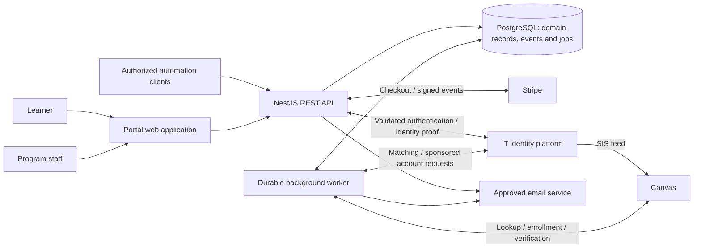

Suggested structure once implementation starts:

```text
CONTEXT.md                 # Glossary, invariants, ownership
docs/adr/                  # Accepted architecture/policy decisions
docs/runbooks/             # Recovery, reconciliation and rollback
src/web/                   # Next.js website, MUI screens and shared theme
src/server/                # NestJS REST API, authorization, integrations
src/domain/                # Offerings, approvals, orders, entitlements
src/worker/                # Durable workflows and lifecycle jobs
tests/                     # Domain, integration and browser checks
```

All privileged actions execute on the server with role and record-level authorization. Browser state, Stripe metadata and email addresses never establish ownership or payment authority by themselves. Public catalog responses exclude learner and identity data.

### API and automation support

API support is a first-release architecture requirement, not a later retrofit. Business actions live in shared application services called by API handlers and workers. The website consumes these contracts; any server-rendering or authentication adapter must preserve the same authorization and business rules. Automation never writes directly to the database or simulates UI clicks.

Use versioned REST/JSON endpoints under `/api/v1`, an exported OpenAPI specification, and interactive API documentation in approved environments. Define request/response schemas, permissions, error codes, pagination/filtering and examples alongside each workflow. Generate a TypeScript client for the website; document Python and command-line examples for future automation. No GraphQL or custom SDK is required initially.

| Automation capability | Proposed API examples | Boundary |
| --- | --- | --- |
| Read catalog and availability | `GET /api/v1/offerings` | Public responses exclude personal data |
| Create/update/publish offerings | `POST /api/v1/offerings`, `PATCH /api/v1/offerings/{id}`, `POST /api/v1/offerings/{id}/publish` | Catalog-management permission; normal validation and audit |
| Read and decide approval requests | `GET /api/v1/approval-requests`, `POST /api/v1/approval-requests/{id}/decision` | Scoped approval authority; preserve any required human review |
| Read orders and access status | `GET /api/v1/orders`, `GET /api/v1/entitlements` | Restricted record visibility; cannot set payment status manually |
| Queue approved operational work | `POST /api/v1/transfers`, `POST /api/v1/exceptions/{id}/retry` | Same policy, capacity, sponsorship and authorization checks as staff UI |
| Check asynchronous outcomes | `GET /api/v1/operations/{id}` | Return pending/running/succeeded/failed and safe error detail |
| Export reconciliation data | `GET /api/v1/reconciliation` | Restricted reporting scope, bounded queries and minimal personal data |

Endpoint names are proposed contracts to finalize before implementation. Provisioning follows a valid paid entitlement; there is no unrestricted enroll-user, disable-account or mark-order-paid endpoint. Finance continues initiating refunds through Stripe in the initial scope; the API can expose permitted refund status and requests without changing that ownership.

Machine clients use dedicated service identities with short-lived tokens, narrowly scoped permissions, revocation and audit attribution. Prefer OAuth 2.0 client credentials through an approved provider; verify provider support in M0. Browser users use approved session/SSO authentication. Define scopes such as `catalog:write`, `approvals:decide`, `orders:read`, `exceptions:retry` and `reports:read`, together with offering/program restrictions. A service identity does not impersonate a learner or bypass fresh-sign-in requirements.

Mutating workflow commands support idempotency keys, with key/request matching and documented retention. Use resource versions or conditional updates to prevent accidental overwrites. Long-running actions return `202 Accepted` with an operation ID and status URL, not a premature success message. Document rate limits, retry guidance and stable error responses. Audit both the calling service and the initiating actor when applicable.

Capture domain events through a transactional outbox from the beginning. Add signed outbound webhooks when automation integrations are introduced, with events such as `offering.published`, `approval.decided`, `order.paid`, `enrollment.verified` and `exception.opened`. Delivery is at least once: include event ID, schema version and timestamp; persist delivery attempts, use bounded retries and support authorized replay. Subscribers deduplicate and can query the API for current state. Minimize webhook personal data and validate configured destinations. Outbound automation notifications are separate from inbound Stripe webhooks.

M1 establishes API documentation, authorization and operation-status conventions. M2–M5 implement workflow endpoints with their corresponding UI. Before pilot release, demonstrate one scoped machine client reading offerings and performing an authorized sandbox action, including denied scopes, duplicate-command retries and asynchronous failure handling. Outbound subscriber management and webhook delivery can follow when needed without redesigning the domain model.

### Domain records and invariants

| Record | Key fields / constraints |
| --- | --- |
| Learner | Internal ID, verified contact address; authentication accounts linked separately |
| Identity link | Durable university ID, type, sponsorship evidence, SIS mapping; unique university identity link |
| Course product / offering | Category, descriptions, price/currency, dates/timezone, capacity, approval rule, Canvas mapping, publication state |
| Approval | Learner/offering, decision, actor, decision time, validity window |
| Seat reservation | Learner/offering, Checkout Session, expiry, reserved/consumed/released state |
| Order / order event | Price snapshot, Stripe identifiers, append-only payment/refund/dispute events; derived current status |
| Entitlement | Learner/offering access justification, lifecycle state and enrollment reference |
| Integration event / job | Unique event and operation keys, attempts, next retry, outcome, correlation ID |
| Audit / exception | Actor, action, object, timestamp, reason, owner and resolution; exclude secrets |

Enforce atomic capacity reservation and one active entitlement per learner/offering. Different Stripe event IDs concerning the same session must still result in one fulfillment. Keep payment, entitlement and identity states separate. A university identity is linked only through an approved proof process, including SSO for an existing identity.

## Corrections and decisions required from v2

| Source assumption or gap | Implementation treatment |
| --- | --- |
| Canvas Catalog is not actively maintained | Remove that unsupported rationale. Instructure currently offers [Canvas Catalog](https://www.instructure.com/canvas/catalog). Retain the custom-portal direction provisionally; document its fit/cost justification with the sponsor before major integration work. |
| A 30-minute hold always guarantees a paid seat | Use atomic capacity allocation and Stripe session reconciliation. Disable delayed payment methods for the initial pilot. A later delayed-payment release must retain capacity while processing or define a Finance-approved exception/refund policy. |
| Browser cancellation releases a seat | A return/cancel page is not authoritative. Release only after confirmed expiration/cancellation semantics; reconcile sessions if webhooks are delayed. Stripe supports expiration from 30 minutes to 24 hours and sends an expiration event. See [Stripe inventory guidance](https://docs.stripe.com/payments/checkout/managing-limited-inventory). |
| Email code cannot be used on another device | Bind the code challenge to the requesting browser/session and enforce attempt limits. A code alone does not establish that property. Have Security approve recovery and account-linking behavior. |
| 14-day warning plus 7-day withdrawal grace | These defaults conflict for immediate withdrawal. Obtain an explicit expedited-notice rule or a longer grace period; do not silently implement both. |
| Expiry includes only Enrolled/Completed entitlements | Include paid provisioning obligations in the protection rule so a second purchase awaiting SIS cannot trigger premature disablement. IT must approve the exact state/date calculation. |
| Refund always revokes access | Distinguish full, partial, pending and failed refunds. Finance/Program Operations define which changes revoke access; dispute-open and dispute-lost are separate decisions. Handle reversal while provisioning is still pending. |
| Offering end means Completed | Track entitlement end separately from academic completion or certificate eligibility. Obtain completion evidence from the approved learning record system. |
| Canvas access removal deletes enrollment | Select and test the appropriate enrollment state with Canvas Administration; retain required records and avoid deletion by default. |
| SIS every two hours, eight-hour escalation | Treat these as planning assumptions pending IT verification. Make timings configurable and publish only an approved learner-facing expectation. |

## Portal workflows

Workflows 1–9 describe recurring portal behavior: catalog administration, learner registration and access, and ongoing operations. They include actions performed by learners, staff and connected systems; the portal does not perform every step itself. For example, Finance initiates refunds in Stripe, IT provisions identities, and the portal tracks and coordinates the resulting changes.

These diagrams describe proposed behavior, not live integrations. Solid arrows are requests/actions; dashed arrows are responses or notifications. The Portal includes server-side authorization and domain logic; the Worker performs durable background work. Every staff action requires its authorized role. Policy-dependent branches remain subject to the decisions above. The one-time course migration and launch process appears in the separate project section after these diagrams.

| Workflow | Portal area | Related milestone |
| --- | --- | --- |
| 1. Publish an offering | Catalog administration | M2 |
| 2. Learner sign-in and university identity linking | Learner registration and access | M1, M4 |
| 3. Approval and pre-payment identity checks | Learner registration and access | M2, M3 |
| 4. Checkout, payment confirmation and seat release | Learner registration and access | M3 |
| 5. Courtesy provisioning and Canvas access | Learner registration and access | M4 |
| 6. Refund, withdrawal or dispute | Ongoing operations and support | M5 |
| 7. Staff-assisted transfer | Ongoing operations and support | M5 |
| 8. Courtesy expiry, notices and disablement | Ongoing operations and support | M5 |
| 9. Reconciliation and exception recovery | Ongoing operations and support | M6 |

### Catalog administration

This is normal staff use of the portal, whether publishing a migrated course or a newly created course. It does not move course content into Canvas.

#### 1. Publish an offering

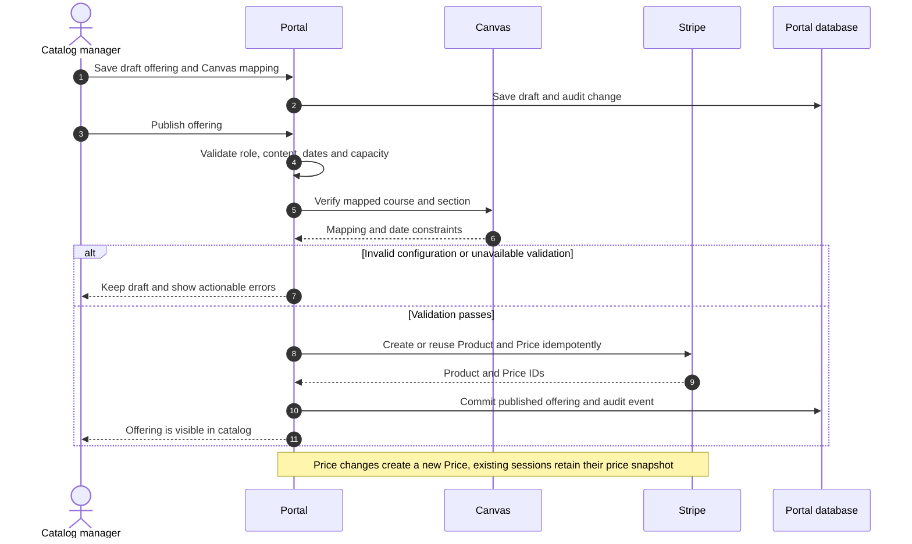

### Learner registration and access

These workflows take a learner from portal sign-in through eligibility checks, payment and verified course access. Staff approvals and IT provisioning are part of that recurring journey.

#### 2. Learner sign-in and university identity linking

The authentication provider is selected in M0/M1. A new learner can have a portal account before a university identity exists. Existing CedarNet users use SSO; active Courtesy users transition to approved SSO after activation. Recovery follows Security-approved policy.

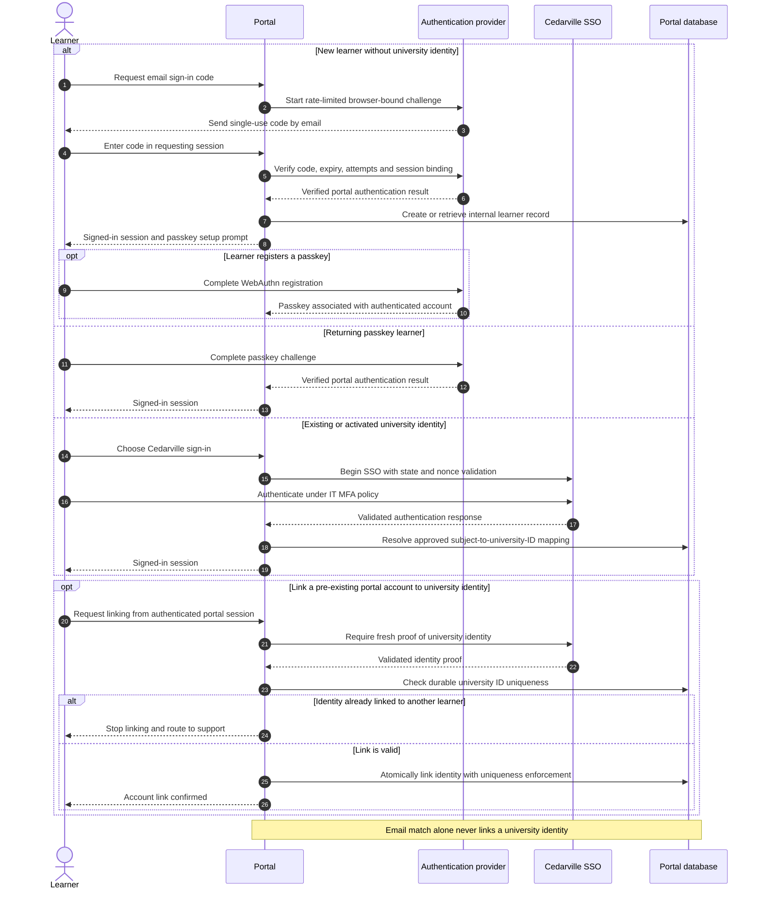

#### 3. Approval and pre-payment identity checks

Approval does not reserve capacity. Checkout must repeat approval validity, enrollment-window and capacity checks. Ambiguous identity results require authorized review before any payment.

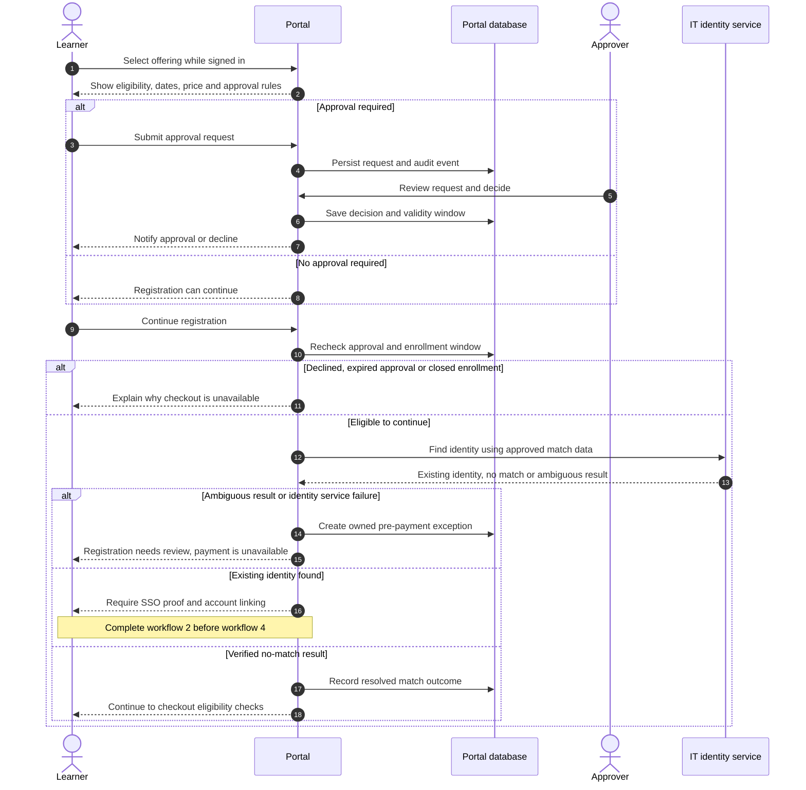

#### 4. Checkout, payment confirmation and seat release

The pilot uses immediate payment methods. Closing the browser or visiting the cancel page does not release a seat. A delayed or unavailable Stripe response leaves a reservation under reconciliation rather than making it available for resale.

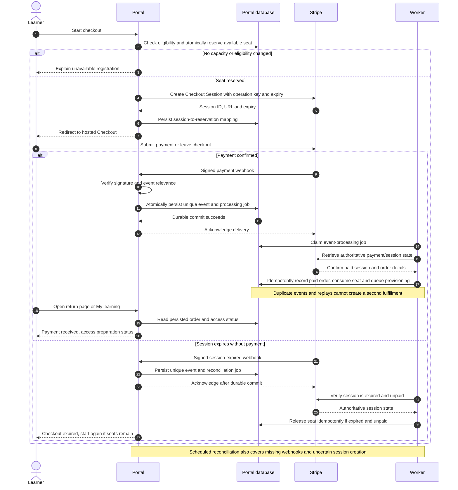

#### 5. Courtesy provisioning and Canvas access

Existing university identities skip Courtesy provisioning. Account activation and Canvas enrollment are tracked independently. Retry duration and learner-facing timing require IT approval.

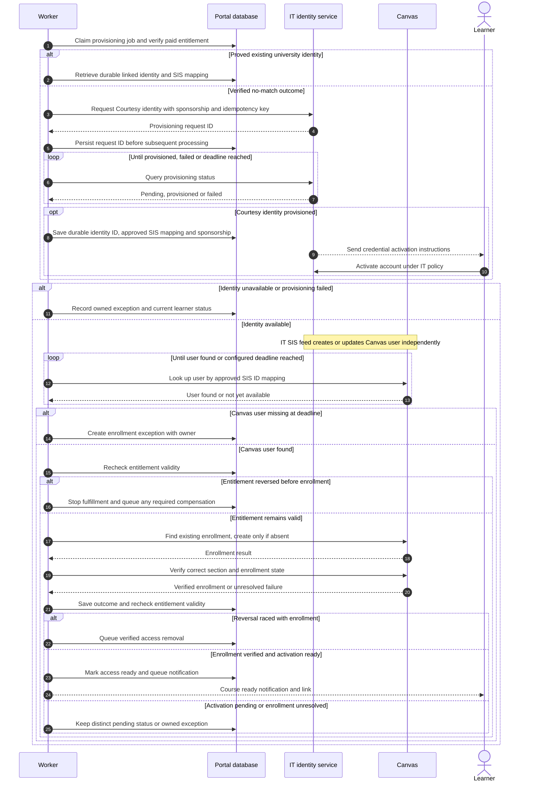

### Ongoing operations and support

These workflows manage changes and failures after registration. They remain portal operational workflows even when authorized staff or external systems perform some steps. Reconciliation in workflow 9 is ongoing payment/access checking, rather than a project migration check.

#### 6. Refund, withdrawal or dispute

Refund state and course-access state remain separate. A pending, failed or partial refund does not automatically revoke access. Open disputes and lost disputes follow distinct approved rules.

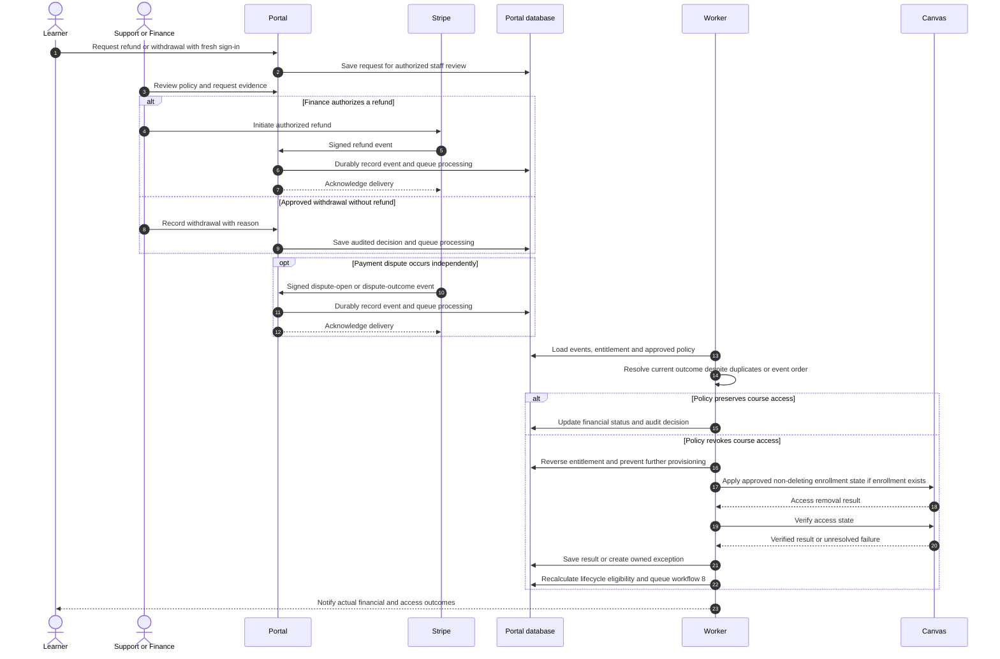

#### 7. Staff-assisted transfer

Transfers require a defined recovery strategy across two Canvas sections. Keep original access until target enrollment is verified; if source removal fails, record temporary overlap as an exception rather than silently declaring success. Finance decides any price adjustment separately.

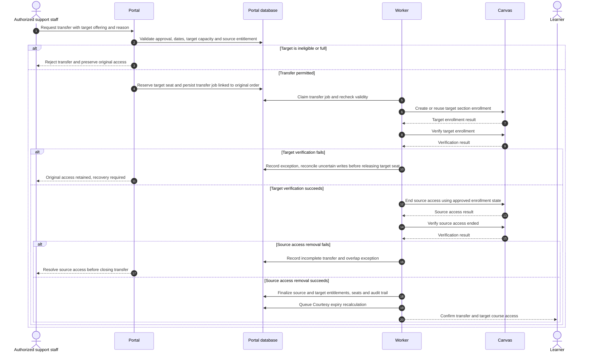

#### 8. Courtesy expiry, notices and disablement

Expiry is recalculated after entitlement changes and checked by a scheduled job. Existing CedarNet accounts are excluded. Protection against concurrent purchases must be part of the IT contract, not just a local check performed before a remote request.

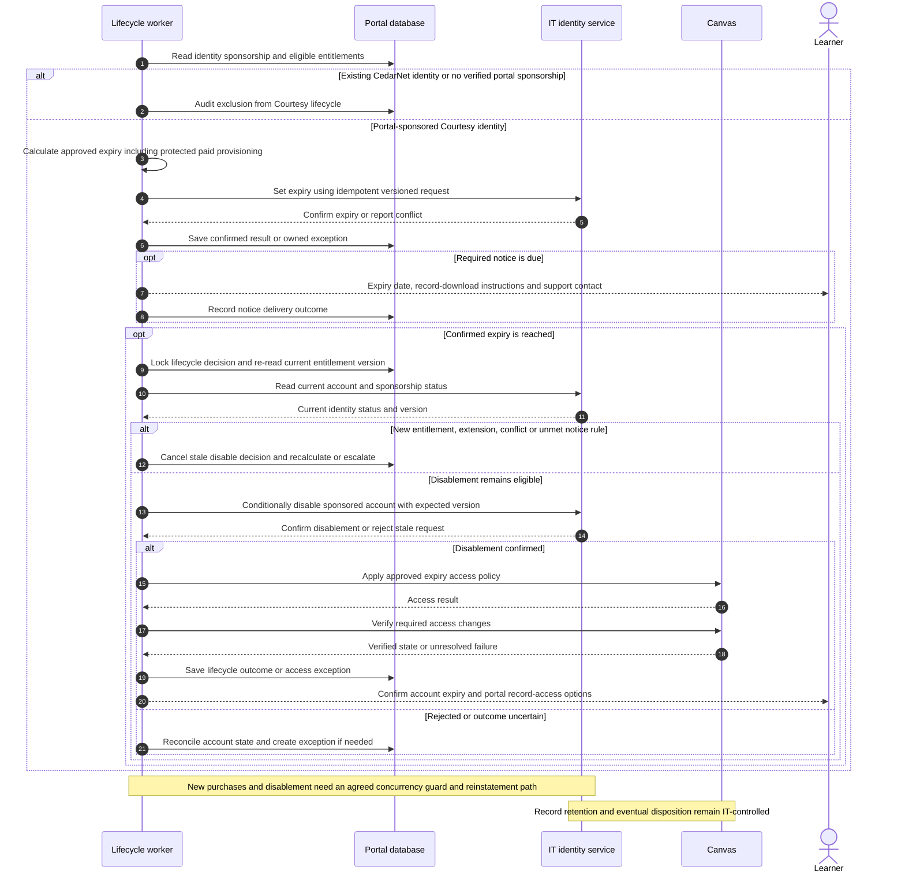

#### 9. Reconciliation and exception recovery

Reconciliation finds missing or inconsistent outcomes without blindly repeating external writes. Support uses scoped actions and runbooks; manual enrollment is performed by Canvas Administration when the runbook requires it.

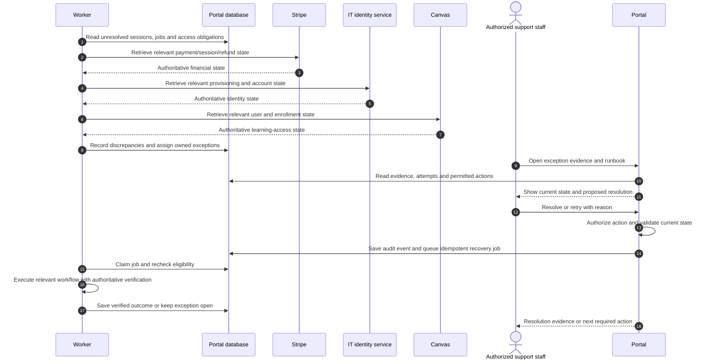

## Project migration and cutover

This section describes the project team's transition process, not a portal feature or automated portal workflow. It applies only if replacing an existing course platform is confirmed in scope and runs alongside portal development.

Here, **migrate** means transferring or rebuilding existing lessons, files, videos, quizzes and assignments in Canvas, then verifying that they work. Learner accounts, grades, completion records and certificates require separate decisions about transfer or preservation; moving course content does not automatically move those records. **Cutover** means switching the approved learner entry points to the new portal and Canvas setup.

### 10. Course migration and cutover

Related milestone: parallel migration workstream. Course-owner QA and cutover approval precede learner redirection or source-platform retirement. Publishing offering mappings uses portal workflow 1; content migration and launch approval remain project responsibilities.

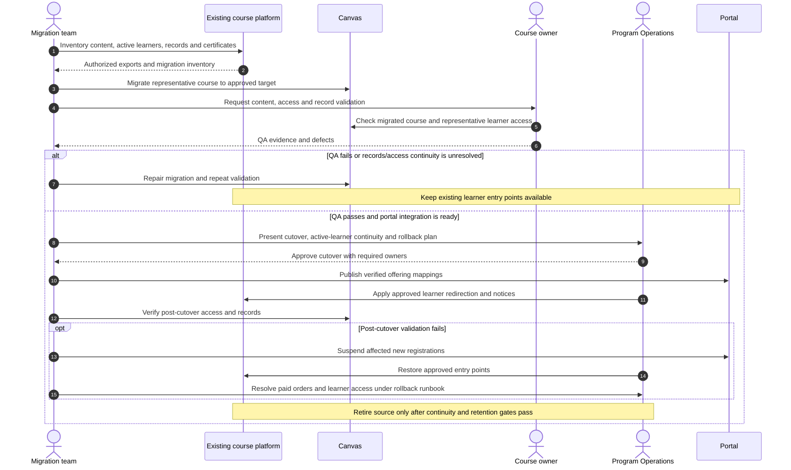

## Delivery sequence

Milestones are dependency based, not promised dates. Start content migration and sandbox development in parallel. The IT identity contract is the principal integration dependency.

### M0 — Establish decisions and contracts

Owners: portal lead, Program Operations, IT Identity, Canvas Administration, Finance and Security.

Deliver the domain glossary; ADRs for build-versus-buy, UI library, backend/hosting, authentication and job persistence; identity API mock and versioned contract; approved Canvas mapping; and a decision register with owner/due date. Confirm approval, capacity, tax, refund/dispute, age, retention, expiry and recovery policies.

Identity contract covers `findIdentity`, asynchronous Courtesy provisioning/status, setting expiry earlier or later, identity status, disablement and reinstatement. Include idempotency, error taxonomy, ambiguous-match handling, least-data responses and proof of portal sponsorship. Permanent deletion is not a portal operation.

Exit: mocks and isolated environments permit development; every production blocker has an owner. Policy decisions may remain open for sandbox work.

### M1 — Foundation and interface baseline

Create the application, migrations, environment separation, server authorization, shared MUI theme and CI for lint/type/build checks. Select a maintained authentication solution supporting approved email challenge, passkeys and university SSO; staff always use SSO/MFA. Implement record-level isolation and audit logging from the first staff write.

Deliver the four representative screens above with mock data, sign-in/linking spike and seeded offerings. Pin dependency versions after compatibility checks.

Exit: approved visual baseline; browser checks cover learner/staff access isolation, keyboard flow and mobile layout. No custom form, menu or dialog interaction replaces an available library component without a documented reason.

### M2 — Catalog, offerings and approvals

Implement draft/publish lifecycle, categories/search, dated offerings, immutable price history, Canvas mapping validation and approval expiry. Publish only when required data, active price and mapped section are valid. Validate dates deliberately rather than assuming every Canvas date must equal an offering date.

Deliver learner requests, staff approval queue and decision notices. Audit price, mapping, capacity, publication and approval changes.

Exit: authorized staff publish and manage an offering without code changes; approval-gated checkout is denied until a valid approval exists. Publishing a new price preserves existing Checkout Sessions.

### M3 — Sandbox checkout and durable fulfillment

Perform identity matching/link proof before payment, then atomically reserve capacity. Create Stripe Products/Prices and Checkout Sessions server-side using idempotency keys. Persist reservation-to-session mapping; recover interrupted session creation without leaking seats.

Verify webhook signatures against the raw request body. Commit the received event and durable work atomically, acknowledge promptly and fulfill only after authoritative payment confirmation. Use unique Stripe event IDs plus session/operation constraints. The return page reads server status.

Reconcile expired and paid sessions before releasing capacity; do not release merely because local time elapsed while Stripe outcome is unknown. Disable automatic Checkout recovery unless recovered sessions repeat availability/approval checks. Retry uncertain network outcomes using the same operation key.

Exit: concurrent checkout for the last seat cannot oversell; duplicate/out-of-order deliveries and worker crashes do not duplicate orders or jobs; expired sessions free seats safely. Validate behavior against [Stripe fulfillment guidance](https://docs.stripe.com/checkout/fulfillment) during implementation.

### M4 — Identity, Canvas and learner status

Implement identity and Canvas adapters against mocks, then approved test services. Request a Courtesy identity only for a proved no-match outcome. Persist request ID and sponsorship; handle asynchronous activation separately from Canvas enrollment.

Look up Canvas users by confirmed SIS mapping, retry with bounded backoff and raise owned exceptions at the configured deadline. Verify an existing enrollment before retrying uncertain writes. Recheck entitlement validity before and after external operations; reversal during provisioning triggers compensating access removal without duplicate identity creation.

IT sends credential activation messages. The portal sends order/access messages and shows payment, activation and enrollment status distinctly. A ready-course link requires the appropriate verified access/activation status.

Exit: one paid test order produces one verified enrollment, delayed SIS and activation are visible, and unrecoverable failures enter an owned queue. Existing CedarNet accounts are never modified.

### M5 — Reversals, lifecycle and support operations

Implement approved full/partial refund and dispute rules, staff-assisted withdrawals/transfers, reconciliation and safe job retry. Transfers reserve target capacity and coordinate enrollment changes as a recoverable workflow; never discard original access without a recovery path.

Calculate Courtesy expiry from approved eligible entitlements, including protected paid provisioning obligations. Use compressed dates in tests. Before disablement, re-read current entitlements and sponsorship, detect concurrent purchases and conflicting IT updates, send required notice and retain an audit record. IT enforces the sponsorship boundary independently. Existing CedarNet identities have no portal lifecycle.

Provide staff roles for approver, catalog manager, support, Finance and IT/Canvas administrator. Sensitive retries and lifecycle actions require reason, preview and scoped authorization. Support must resolve normal exceptions without direct database edits.

Exit: test reversals preserve records, recalculate expiry correctly and cannot disable reused identities. Retention disposition remains IT-controlled. Learner records remain accessible through the approved post-disablement authentication method.

### M6 — Operational readiness and closed pilot

Deliver dashboards/alerts for webhook failures, queue age, provisioning delays and unowned exceptions; daily paid-versus-enrolled and sponsorship reconciliation; secret rotation, backup/restore and deployment runbooks. Finance/Security confirm payment compliance and privacy requirements rather than inferring them from hosted Checkout alone.

Run one low-risk offering with a small cohort after production gates pass. Exercise lifecycle expiry in the isolated environment; monitor the real pilot through offering completion before broader release.

Exit: all criteria below pass and Program Operations, IT Identity, Canvas Administration and Finance approve results.

### Parallel workstream — Existing course migration

If Teachable or another catalog is being replaced, begin inventory and representative-course migration during M0. Verify this scope and staffing with Program Operations; older planning dates are not release commitments. Inventory content, learner records, certificates, active enrollments, rights and dependencies. Map offerings to Canvas, migrate representative content and conduct course-owner QA independently of portal integration.

Do not redirect learners or retire the source platform until content, access, records and support continuity are verified. Preserve a rollback path and distinguish historical-record migration from new paid enrollment.

### Course schedule types

Support two explicit offering types: cohort courses have scheduled start/end dates; learn-on-your-own courses start anytime and have no cohort dates. Keep course type separate from delivery format, enrollment windows and access-duration rules. Catalog cards, spotlight, course details and learner records must use the appropriate schedule label. Staff choose the type before entering dates; API and database validation reject missing cohort dates or cohort dates on an anytime course.

## Verification and release gates

| Area | Required evidence |
| --- | --- |
| Interface | Brand review; desktop/mobile screenshots; functional verification of changed workflows |
| Accessibility | Required in each UI review using the README review/test checklist; keyboard/focus, names/labels/semantics, contrast, targets, reflow/zoom and announcements; automated scan plus manual screen-reader review of registration, sign-in, errors, dialogs and staff tables before release; record unresolved findings and unperformed checks |
| Authorization | Learner cannot read another learner's records; staff scopes enforced server-side; SSO linking and recovery cannot claim another identity |
| Payments/capacity | Success, decline, abandoned/expired checkout, final-seat concurrency, duplicate/out-of-order webhook, crash/replay and unavailable Stripe reconciliation |
| Provisioning | Ambiguous identities blocked before payment; existing identity reused safely; asynchronous IT/SIS delays; uncertain enrollment response and retry; reversal during provisioning |
| Reversals/lifecycle | Full/partial/failed refund, dispute outcomes, transfer recovery, new purchase near expiry, notice rules, protected provisioning and existing-identity immunity |
| Operations | Restore drill, job recovery, tested alerts, owner assignment, Finance reconciliation and manual-enrollment procedure |
| Migration | Course-owner content/access/record QA and explicit source-platform cutover approval, if applicable |

Pilot metrics: every paid learner is enrolled within the approved deadline or has an owned exception; no duplicate identities/enrollments; no unauthorized identity changes; no unexplained financial or access reconciliation differences; all tested reversals follow approved policy; support resolves normal exceptions through the staff interface. An owned exception is an escalation success, not an enrollment success—report these rates separately.

Production blockers: approved identity/authentication contract, live SIS timing/mapping, lifecycle and notice rules, Finance payment/refund/tax rules, hosting/backup/retention ownership, accessibility acceptance and pilot course readiness. Sandbox uses synthetic data, Stripe test mode and isolated Canvas/identity environments; it cannot touch production identities or enrollments.

Rollback: unpublish affected offerings and prevent new Checkout Sessions, while reconciling existing sessions and processing already-paid orders. Keep webhooks and workers running; route exceptions to designated staff. Canvas Administration handles controlled manual enrollment. Never bulk-delete learner, identity, payment or learning records as rollback.

## GitHub execution plan

Create GitHub issues only when the user explicitly requests them. Prepare planning updates locally; publish or synchronize them to the tracker when authorized. For an authorized planning issue, use the existing `documentation` label. Use canonical triage labels only when their meanings apply; missing labels are not a reason to invent alternate names. The initial plan needs sponsor decisions and is not a fully specified `ready-for-agent` task.

When issue creation is explicitly requested and contracts are concrete, split milestones into implementation issues. Each issue must state scope/exclusions, prerequisites, relevant ADR/contract, affected UI states, acceptance criteria and validation evidence. Record dependencies explicitly. Start with M0 decisions and the M1 interface spike; do not mark integration work ready while its contract is unresolved. When tracker updates are authorized, synchronize the repository copy and planning issue.
